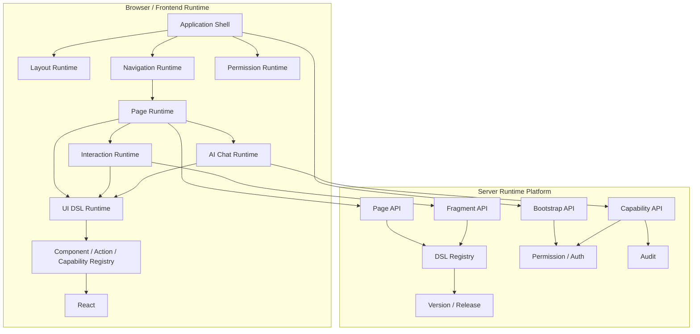

> 文档版本：v1.0  
> 文档状态：架构设计与开发规范  
> 适用范围：企业管理后台、动态配置平台、运营平台、AI Native 应用、Server-Driven UI 场景  
> 前端基础技术栈：TypeScript + React + Vite  
> 推荐 UI 基础库：Ant Design（通过框架适配层使用，不直接暴露为 DSL 协议）

---

# 1. 文档目的

本文档用于定义一套可通过 npm 依赖方式引入业务工程的公共前端基础框架。

该框架以 **YAML/JSON DSL** 描述应用、页面、布局、菜单、权限、组件、数据源、事件、动作、交互层和 AI Chat 内容，并由浏览器中的公共 Runtime 动态渲染。

核心目标：

1. 业务前端工程通过 `npm install` 引入公共框架。
2. 业务页面不必随前端代码一起打包。
3. 菜单、页面 DSL、权限、布局和部分运行配置可以通过 API 动态加载。
4. 新增或修改普通业务页面时原则上无需重新构建和发布前端。
5. 页面、弹窗、Drawer、表单弹层、Chat 消息中的 UI 共用一套 DSL Renderer。
6. 支持普通企业应用，也支持 Markdown + DSL 的 AI Chat 交互。
7. 保留 TypeScript/React 扩展能力，避免 DSL 演变为不可维护的“万能语言”。
8. 通过 Registry、Capability、权限和白名单机制控制动态能力边界。

---

# 2. 框架定位

本框架定名为 **Pactor**。

本框架不是简单的 YAML Renderer，也不是单纯的 React 组件库。

其定位为：

> **Pactor — Dynamic Application Runtime**
>
> 一套面向企业应用的 Server-Driven UI + AI-Native 前端运行时框架。

命名约定：

- 框架名：**pactor**
- npm 包不使用 scope，各模块包名统一 `pactor-` 前缀，如 `@pactor/core`、`@pactor/schema`、`@pactor/expression`、`@pactor/app`
- Monorepo 目录名保持简短（如 `packages/core`），与包名分离

不建议将项目命名为：

- yaml-renderer
- yaml-ui
- dsl-ui

因为这些名称无法表达菜单、路由、权限、交互层、应用布局、动态发布和 AI Runtime 等完整能力。

---

# 3. 核心设计原则

## 3.1 DSL 是协议，不只是配置文件

DSL 应描述：

- 应用
- 页面
- 布局
- 状态
- 数据源
- 组件
- 属性
- 条件
- 权限
- 事件
- 动作
- 生命周期
- Overlay
- Chat
- AI Capability

而不是只描述：

```yaml
type: Button
props:
  text: 保存
```

## 3.2 Runtime 是框架核心

核心价值在于：

```text
DSL
  ↓
Parser / Validator
  ↓
Runtime Context
  ↓
Expression / Permission / DataSource
  ↓
Component Registry
  ↓
React Renderer
```

而不是“提供一批组件”。

## 3.3 动态 DSL，静态能力

服务端可以动态下发：

- 页面 DSL
- 菜单
- 权限
- 布局配置
- 数据源配置
- 动作编排
- Chat DSL
- Fragment

但 DSL 能调用哪些能力必须由前端 npm Runtime 明确定义：

- Component Registry
- Action Registry
- Service Registry
- Capability Registry
- Expression Function Registry

**禁止服务端通过 DSL 注入任意 JavaScript。**

## 3.4 复杂业务必须允许逃逸到 React/TypeScript

推荐目标：

```text
70%～80% 常规页面：纯 DSL
15%～25% 页面：DSL + 自定义 Component / Action / Service
5% 左右复杂页面：直接 React
```

不要试图通过 YAML 表达所有复杂业务逻辑。

## 3.5 前端权限只控制 UI，后端权限才是安全边界

前端可以：

- 隐藏菜单
- 禁止页面访问
- 隐藏按钮
- 禁用组件
- 拦截动作

但后端 API 仍必须再次鉴权。

---

# 4. 总体架构

```mermaid
flowchart TB
    A[Business Application] --> B[@pactor/app]
    B --> C[Application Shell]
    C --> D[Layout Runtime]
    C --> E[Navigation Runtime]
    C --> F[Permission Runtime]
    E --> G[Dynamic Router]
    G --> H[Page Resource Loader]
    H --> I[Page Runtime]
    I --> J[UI DSL Runtime]
    I --> K[Interaction Runtime]
    I --> L[Chat Runtime]
    J --> M[Component Registry]
    K --> J
    L --> J
    M --> N[React]
    H --> O[Runtime API]
    O --> P[Menu / Page / Fragment / Permission / Theme / Release Registry]
```

另一种分层视图：

```text
┌──────────────────────────────────────────────────────────────┐
│                      Business Application                    │
│                 npm install @pactor/app                     │
├──────────────────────────────────────────────────────────────┤
│                       Application Shell                      │
│     Auth / Bootstrap / Theme / Error / Loading / Session     │
├──────────────────────────────────────────────────────────────┤
│                        Layout Runtime                        │
│     Login / Landing / Admin / Dashboard / Chat / Blank       │
├──────────────────────────────────────────────────────────────┤
│                      Navigation Runtime                      │
│         Menu / Router / Tabs / Breadcrumb / Permission       │
├──────────────────────────────────────────────────────────────┤
│                         Page Runtime                         │
│     DSL Loader / Context / State / DataSource / Lifecycle    │
├──────────────────────────────────────────────────────────────┤
│                    Interaction Runtime                      │
│ Modal / Drawer / FormModal / FormDrawer / Confirm / Popover  │
├──────────────────────────────────────────────────────────────┤
│                       AI Chat Runtime                        │
│ Markdown / DSL Part / Tool / Streaming / Capability / Form   │
├──────────────────────────────────────────────────────────────┤
│                       Runtime Engine                         │
│ Event / Action / Expression / Registry / Permission / Cache  │
├──────────────────────────────────────────────────────────────┤
│                       Component System                       │
│ Form / Table / Card / Chart / Navigation / AI Components     │
├──────────────────────────────────────────────────────────────┤
│                      React / Browser                         │
└──────────────────────────────────────────────────────────────┘
```

---

# 5. 前端 Shell 与业务 DSL 的边界

业务 DSL **不负责整个应用外壳**。

公共框架负责：

- 登录态
- Application Shell
- Header
- Sidebar
- Menu
- Tabs
- Breadcrumb
- Footer
- 主内容区
- Dynamic Router
- Permission Guard
- 页面 Loading
- Error Boundary
- 404 / 403 / 500
- Theme
- 国际化基础设施

页面 DSL 负责主内容区域。

典型管理后台：

```text
┌────────────────────────────────────────────────────┐
│ Header                                             │
│ Logo / 系统名                     用户 / 设置       │
├──────────────┬─────────────────────────────────────┤
│ Sidebar      │ Breadcrumb / Tabs                   │
│              ├─────────────────────────────────────┤
│ Menu         │                                     │
│              │       Dynamic DSL Page              │
│              │                                     │
├──────────────┴─────────────────────────────────────┤
│ Footer                                             │
└────────────────────────────────────────────────────┘
```

---

# 6. npm 包结构

采用 Monorepo，将能力拆为独立 npm package。包名不使用 scope，统一 `pactor-` 前缀（见第 2 节命名约定）。

```text
@pactor/core
@pactor/schema
@pactor/expression

@pactor/runtime
@pactor/resource
@pactor/router
@pactor/permission

@pactor/ui
pactor-theme

@pactor/markdown
@pactor/chat

pactor-devtools
@pactor/vite-plugin
@pactor/cli

@pactor/app
```

## 6.1 包职责

### `@pactor/core`

负责与 React 无关的核心协议：

- AST
- DSL Node
- Registry Interface
- Runtime Scope 定义
- Action 定义
- Event 定义
- Page / Fragment 基础类型

### `@pactor/schema`

负责：

- JSON Schema
- TypeScript 类型
- DSL Version
- Component Schema
- Action Schema
- Page Schema
- Chat Message Schema
- Validation Rules

### `@pactor/expression`

负责受控表达式：

- Parse
- AST
- Evaluate
- Function Registry
- Scope Resolve

### `@pactor/runtime`

负责：

- Renderer
- RuntimeContext
- State
- DataSource
- Lifecycle
- Event
- Action
- Page Runtime

### `@pactor/resource`

负责：

- HttpDslResourceLoader
- Page Loader
- Fragment Loader
- Cache
- Version
- ETag
- Resource Metadata

### `@pactor/router`

负责：

- Dynamic Route
- Path Matcher
- Route Params
- Query
- Menu Route Registry
- Hidden Route

### `@pactor/permission`

负责：

- Permission Store
- Page Guard
- Menu Guard
- Component Guard
- Action Guard

### `@pactor/ui`（shadcn）

唯一内置 UI kit 单元（shadcn 风格）：vendored shadcn/ui 组件源码（Base UI 原语 + cva + tailwind-merge + lucide-react），自持 components / interaction / layout 三层（12 组件 props 契约类型、交互核心 OverlayManager / createUiBridge / registerInteractionActions / UiBridge、布局类型与 resolveLayout 均为本包自有），导出 `shadcnUiKit` 预设与预建样式表（Tailwind v4 构建期编译，消费方零 Tailwind 配置；preflight 开启 + tw-animate-css 动画层，对齐 shadcn 官方主题脚手架，令牌挂 `:root` / `[data-pactor-theme='dark']`）。**@pactor/app 的内置默认 UI kit（唯一内置实现）**；自定义组件 / 布局 / 交互层经 componentRegistry / layoutRegistry / interactionKit / ui 覆盖点接入。

### `@pactor/chat`

负责：

- Conversation
- Message
- Message Part
- Markdown
- DSL Part
- Streaming
- Tool State
- Capability
- AI Context Bridge

### `@pactor/app`

对业务工程提供一站式集成能力。

业务项目优先：

```bash
npm install @pactor/app
```

---

# 7. Monorepo 工程结构

推荐使用 pnpm workspace。

```text
pactor/
├── packages/
│   ├── core/
│   ├── schema/
│   ├── expression/
│   ├── runtime/
│   ├── resource/
│   ├── router/
│   ├── permission/
│   ├── ui/
│   ├── markdown/
│   ├── chat/
│   ├── theme/
│   ├── devtools/
│   ├── vite-plugin/
│   ├── cli/
│   └── app/
├── examples/
│   ├── admin/
│   ├── login/
│   ├── landing/
│   ├── chat/
│   └── mixed-runtime/
├── docs/
├── package.json
└── pnpm-workspace.yaml
```

---

# 8. 技术选型建议

| 能力 | 推荐 |
|---|---|
| 语言 | TypeScript |
| View | React |
| Build | Vite |
| Monorepo | pnpm workspace |
| UI | Ant Design，经框架 Adapter 封装 |
| DSL | YAML 作为开发格式，JSON 作为 Runtime 格式 |
| Schema | JSON Schema |
| Validation | Ajv |
| State | 内部 Store 或 Zustand |
| HTTP | Fetch/Axios Adapter |
| Router | React Router |
| Expression | 自研受控 AST 或 jsep 类解析方案 |
| Unit Test | Vitest |
| Component Test | Testing Library |
| E2E | Playwright |
| Docs | VitePress |
| Package Registry | npm / 私有 npm Registry |

---

# 9. DSL 分层模型

推荐将 DSL 分成四级。

## 9.1 Application DSL

定义整个产品：

```yaml
application:
  id: risk-console
  layout:
    type: admin
  theme:
    name: default
  navigation:
    mode: side
```

## 9.2 Page DSL

定义页面：

```yaml
page:
  id: customer-list
  type: list
  title: 客户管理
```

## 9.3 Fragment / UI DSL

定义 UI 树：

```yaml
type: Card
props:
  title: 客户详情
children:
  - type: Statistic
```

## 9.4 Interaction DSL

定义：

- action
- condition
- permission
- event
- expression

Chat 在此基础上增加：

```text
Message Protocol
+
UI DSL
```

---

# 10. 标准 DSL 根结构

建议 Page DSL 基础格式：

```yaml
dsl: "1.0"

requires:
  runtime: ">=1.0.0"

page:
  id: customer-list
  title: 客户管理
  type: list
  permission: customer:view

state:
  keyword: ""
  selectedRows: []

dataSources:
  customers:
    type: service
    service: customer.list
    autoLoad: true
    params:
      keyword: "${state.keyword}"

lifecycle:
  onInit: []
  onLoad: []

body:
  type: Page
  children: []
```

---

# 11. DSL Core Node

基础节点推荐定义：

```ts
export interface DslNode {
  id?: string;
  type: string;
  props?: Record<string, unknown>;
  children?: DslNode[];
  events?: Record<string, DslAction | DslAction[]>;
  permission?: PermissionConfig;
  when?: ConditionConfig;
}
```

---

# 12. UI Component Registry

禁止 Renderer 中出现大量：

```ts
if (type === 'Button') {}
if (type === 'Input') {}
if (type === 'Table') {}
```

必须使用 Registry：

```ts
const registry = new ComponentRegistry();

registry.register('Button', ButtonRenderer);
registry.register('Table', TableRenderer);
registry.register('Input', InputRenderer);
```

核心 Renderer：

```tsx
function renderNode(node: DslNode, context: RuntimeContext) {
  const Component = registry.get(node.type);

  if (!Component) {
    return <UnsupportedComponent type={node.type} />;
  }

  const props = resolveProps(node.props, context);

  return (
    <Component {...props}>
      {node.children?.map(child => renderNode(child, context))}
    </Component>
  );
}
```

业务扩展：

```ts
runtime.registerComponent(
  'RiskScore',
  RiskScoreComponent
);
```

DSL：

```yaml
type: RiskScore
props:
  score: "${row.riskScore}"
```

---

# 13. 组件分层

## Level 1：基础组件

- Button
- Input
- Select
- Checkbox
- Radio
- DatePicker
- Table
- Tabs
- Form
- Grid
- Card
- Modal
- Drawer

## Level 2：企业组件

- SearchForm
- CrudTable
- DetailPanel
- EditableTable
- TreeTable
- Descriptions
- Upload
- FilterBar
- Toolbar
- PageHeader

## Level 3：业务组件

业务工程自行注册：

- RiskScore
- StrategyEditor
- DecisionFlow
- ModelMonitor
- CustomerProfile

Level 1/2 属于公共 npm Framework。

Level 3 属于业务项目或业务组件包。

---

# 14. 不直接暴露 Ant Design DSL

推荐：

```text
Business DSL
   ↓
Framework Component
   ↓
Ant Design Adapter
   ↓
Ant Design
```

推荐写法：

```yaml
type: Button
props:
  variant: primary
```

不建议：

```yaml
type: AntButton
props:
  ghost: false
  danger: false
  htmlType: button
```

避免 DSL 与具体 UI Library API 强绑定。

---

# 15. Runtime Context

推荐统一 Context：

```ts
interface RuntimeContext {
  app: AppContext;
  page: PageContext;
  state: StateStore;
  data: DataSourceStore;
  form: FormStore;
  route: RouteContext;
  user: UserContext;
  permission: PermissionContext;
  services: ServiceRegistry;
  components: ComponentRegistry;
  actions: ActionRegistry;
  capabilities: CapabilityRegistry;
}
```

运行时作用域：

```text
global
  ↓
app
  ↓
page
  ↓
overlay
  ↓
form
  ↓
component
  ↓
row
  ↓
event
```

---

# 16. Expression Engine

DSL 中支持：

```yaml
text: "${state.user.name}"
visible: "${state.status == 'ACTIVE'}"
disabled: "${!permission('customer:edit')}"
```

允许的上下文建议包括：

- state
- data
- form
- row
- rowIndex
- route.params
- route.query
- user
- env
- params
- page
- overlay
- event
- actions

## 16.1 禁止 `eval`

禁止：

```ts
eval(expression);
new Function(...)
```

表达式必须基于受控 AST。

允许：

- Literal
- Identifier
- MemberExpression
- BinaryExpression
- LogicalExpression
- ConditionalExpression
- 白名单 FunctionCall

不允许访问：

- window
- document
- localStorage（除非显式适配）
- fetch
- Function
- eval
- 任意全局对象

---

# 17. Action Engine

所有业务行为统一抽象为 Action。

标准 Action：

- request
- reload
- setState
- resetState
- navigate
- message
- confirm
- validate
- submit
- open
- close
- download
- upload
- copy
- delay
- sequence
- parallel
- if
- capability

Action 也使用 Registry：

```ts
interface ActionHandler {
  execute(
    action: ActionConfig,
    context: RuntimeContext
  ): Promise<ActionResult>;
}
```

注册：

```ts
runtime.registerAction(
  'risk.calculate',
  calculateRiskAction
);
```

DSL：

```yaml
action: risk.calculate
params:
  customerId: "${row.id}"
```

---

# 18. Service Registry

对于企业系统，不建议所有 API 都直接写在 YAML。

推荐：

```ts
runtime.registerService(
  'customer',
  customerService
);
```

DSL：

```yaml
dataSources:
  customers:
    type: service
    service: customer.list
    params:
      keyword: "${state.keyword}"
```

优势：

- DTO 可维护
- 认证逻辑统一
- 异常处理统一
- 接口实现可测试
- 避免 DSL 强绑定 HTTP 细节

---

# 19. DataSource

建议标准 DataSource 类型：

- http
- service
- static
- computed
- resource

HTTP 示例：

```yaml
dataSources:
  users:
    type: http
    autoLoad: true
    request:
      method: GET
      url: /api/users
      params:
        keyword: "${state.keyword}"
    pagination:
      page: "${state.page}"
      pageSize: "${state.pageSize}"
```

Runtime 统一维护：

- loading
- error
- data
- pagination
- cache
- refresh
- retry
- cancel

组件只引用：

```yaml
dataSource: "${data.users}"
```

---

# 20. 生命周期

建议提供业务语义生命周期：

- init
- load
- ready
- show
- hide
- destroy

例如：

```yaml
lifecycle:
  onInit:
    - action: setState
      path: ready
      value: false

  onLoad:
    - action: reload
      target: users
```

不建议将 React 生命周期原样暴露给 DSL。

---

# 21. 条件、循环与 Scope

条件：

```yaml
type: Button
when:
  expression: "${state.status == 'ACTIVE'}"
```

或权限优先使用声明式：

```yaml
permission:
  code: customer:edit
```

循环：

```yaml
type: Repeat
source: "${data.products}"
item: product

children:
  - type: ProductCard
    props:
      product: "${product}"
```

Table 自动建立：

- row
- rowIndex

Event 自动建立：

- event
- target

---

# 22. Application Layout 体系

布局需区分三个层级：

1. Application Layout
2. Page Layout
3. Component Layout

---

# 23. Application Layout 类型

V1 建议支持：

| 类型 | 用途 |
|---|---|
| `login` | 登录 |
| `landing` | 官网 / 产品落地页 |
| `admin` | 标准管理后台 |
| `dashboard` | 数据驾驶舱 |
| `workspace` | 编辑器 / 工作台 |
| `chat` | AI 对话 |
| `blank` | 无外壳页面 |
| `embedded` | 嵌入式 |
| `split` | 左右工作区 |
| `master-detail` | 主从结构 |

---

# 24. Admin Layout

标准结构：

```text
┌───────────────────────────────────────────────┐
│ Header                                        │
├────────────┬──────────────────────────────────┤
│ Sidebar    │ Tabs / Breadcrumb                │
│            ├──────────────────────────────────┤
│ Menu       │                                  │
│            │       DSL Page                   │
│            │                                  │
└────────────┴──────────────────────────────────┘
```

配置：

```json
{
  "layout": {
    "type": "admin",
    "header": true,
    "sidebar": true,
    "tabs": true,
    "breadcrumb": true,
    "footer": false
  }
}
```

---

# 25. Login Layout

登录页属于框架标准 Layout。

```yaml
dsl: "1.0"

layout:
  type: login
  variant: split

  brand:
    title: 智能决策运营平台
    logo: /assets/logo.svg
    description: AI Native Decision Platform

page:
  body:
    type: LoginForm
    props:
      username:
        label: 用户名
      password:
        label: 密码
      captcha:
        enabled: true
      submit:
        text: 登录

    events:
      submit:
        action: auth.login
```

登录 Layout Variant 建议：

- center
- split
- cover
- minimal
- enterprise

框架负责：

- 表单校验
- 登录 Action
- Token
- Session
- Loading
- 错误提示
- 登录成功跳转

---

# 26. Landing Layout

Landing 组件集合建议：

- Navbar
- Hero
- Section
- Feature
- FeatureGrid
- Showcase
- Steps
- Metrics
- CTA
- FAQ
- Footer

示例：

```yaml
layout:
  type: landing

page:
  sections:
    - type: Hero
      props:
        title: AI 原生智能决策平台
        subtitle: 让复杂决策更加透明、智能和高效
        actions:
          - text: 立即体验
            variant: primary
          - text: 了解更多
            variant: secondary

    - type: FeatureGrid
      props:
        columns: 4
```

---

# 27. Page Pattern

在底层 Grid/Flex 之上，应提供高层页面模板：

| Pattern | 场景 |
|---|---|
| `list` | 查询列表 |
| `form` | 新增/修改 |
| `detail` | 详情 |
| `dashboard` | 指标 |
| `settings` | 配置 |
| `wizard` | 多步骤 |
| `master-detail` | 主从 |
| `workspace` | 复杂编辑 |
| `chat` | AI |

低层 DSL：

```yaml
type: Flex
children: []
```

高层 DSL：

```yaml
page:
  type: list
```

大量常规业务应优先使用高层 Page Pattern。

---

# 28. 菜单、路由、页面关系

核心关系：

```text
Menu
  ↓
Route
  ↓
pageId
  ↓
Page Registry
  ↓
DSL Version
  ↓
Page Runtime
```

菜单不要直接绑定 React Component。

不建议：

```json
{
  "component": "CustomerList"
}
```

推荐：

```json
{
  "path": "/customers",
  "pageId": "customer-list"
}
```

---

# 29. Bootstrap API

系统登录完成后建议一次加载 Runtime Bootstrap。

```http
GET /api/runtime/bootstrap
```

示例：

```json
{
  "app": {
    "id": "risk-console",
    "name": "智能风控平台"
  },

  "user": {
    "id": "10001",
    "name": "张三"
  },

  "layout": {
    "type": "admin",
    "tabs": true,
    "breadcrumb": true
  },

  "permissions": [
    "customer:view",
    "customer:edit",
    "strategy:view"
  ],

  "menus": []
}
```

---

# 30. Menu Model

建议支持：

- group
- page
- link

```ts
interface MenuItem {
  id: string;
  type: 'group' | 'page' | 'link';
  title: string;
  icon?: string;
  order?: number;
  path?: string;
  pageId?: string;
  permission?: string;
  hidden?: boolean;
  disabled?: boolean;
  external?: boolean;
  target?: string;
  keepAlive?: boolean;
  badge?: string | number;
  activeMenu?: string;
  defaultOpen?: boolean;
  breadcrumb?: boolean;
  tab?: boolean;
  children?: MenuItem[];
}
```

典型配置：

```json
{
  "id": "customer",
  "type": "group",
  "title": "客户管理",
  "icon": "user",
  "children": [
    {
      "id": "customer-list",
      "type": "page",
      "title": "客户列表",
      "path": "/customers",
      "pageId": "customer-list",
      "permission": "customer:view"
    }
  ]
}
```

隐藏详情页：

```json
{
  "id": "customer-edit",
  "type": "page",
  "title": "编辑客户",
  "path": "/customers/:id/edit",
  "pageId": "customer-edit",
  "hidden": true,
  "activeMenu": "customer-list",
  "permission": "customer:edit"
}
```

---

# 31. Dynamic Router

传统 React Router：

```tsx
<Route
  path="/customer"
  element={<CustomerPage />}
/>
```

动态框架应使用：

```tsx
<Route
  path="*"
  element={<DynamicDslRoute />}
/>
```

逻辑：

```ts
function DynamicDslRoute() {
  const location = useLocation();
  const menu = menuRegistry.findByPath(location.pathname);

  if (!menu) {
    return <NotFound />;
  }

  return <DslPage pageId={menu.pageId} />;
}
```

---

# 32. Route Context

访问：

```text
/customers/123?tab=risk
```

Runtime 提供：

```text
route.params.id = "123"
route.query.tab = "risk"
```

DSL：

```yaml
dataSources:
  customer:
    type: service
    service: customer.detail
    params:
      id: "${route.params.id}"
```

---

# 33. Page Resource API

推荐：

```http
GET /api/runtime/pages/{pageId}
```

返回 JSON Runtime 格式：

```json
{
  "pageId": "customer-list",
  "version": 12,
  "dslVersion": "1.0",
  "title": "客户管理",
  "updatedAt": "2026-08-10T10:00:00Z",
  "schema": {
    "page": {},
    "state": {},
    "dataSources": {},
    "body": {}
  }
}
```

---

# 34. YAML 与 JSON 的职责

建议：

```text
YAML = DSL 开发/编辑格式
JSON = Runtime API 格式
```

流程：

```text
YAML
  ↓
Server Parse
  ↓
Schema Validation
  ↓
Normalization
  ↓
Runtime JSON
  ↓
Browser Runtime
```

浏览器不必重复加载 YAML Parser。

---

# 35. DSL Resource Loader

定义统一接口：

```ts
interface DslResourceLoader {
  load(pageId: string): Promise<PageDefinition>;
}
```

实现：

- HttpDslResourceLoader
- StaticDslLoader
- MockDslLoader
- IndexedDbDslLoader

普通生产环境使用 HTTP Loader。

---

# 36. Cache 与版本控制

建议：

```text
Memory Cache
+
Browser Cache
+
ETag
+
Page Version
```

缓存 Key：

```text
customer-list@103
```

访问流程：

```text
load(customer-list)
  ↓
Memory
  ↓ miss
Browser Cache
  ↓
GET /runtime/pages/customer-list
If-None-Match: xxx
  ↓
304 / 200
```

Bootstrap 可返回：

```json
{
  "pageId": "customer-list",
  "pageVersion": 103
}
```

版本变化即重新加载。

---

# 37. DSL 版本

DSL 根节点强制：

```yaml
dsl: "1.0"
```

建议区分三种版本：

1. DSL Specification Version
2. Runtime Version
3. Component API Version

示例：

```yaml
dsl: "1.2"

requires:
  runtime: ">=2.3.0"
  components:
    RiskScore: ">=1.1.0"
```

Runtime 加载 DSL 前进行 capability validation。

---

# 38. 权限模型

至少四层：

```text
Menu Permission
Page Permission
Component Permission
Action Permission
```

---

# 39. Menu Permission

```json
{
  "title": "策略管理",
  "permission": "strategy:view"
}
```

无权限则菜单不显示。

---

# 40. Page Permission

页面本身仍需校验：

```yaml
page:
  permission: strategy:view
```

即使用户手工输入 URL：

```text
/strategies
```

仍必须经过 Permission Guard。

---

# 41. Component Permission

```yaml
type: Button
props:
  text: 编辑

permission:
  code: customer:edit
  denied: hidden
```

`denied` 推荐：

- hidden
- disabled
- readonly

---

# 42. Action Permission

```yaml
events:
  click:
    - action: capability
      permission: customer:delete
      name: customer.delete
      params:
        id: "${row.id}"
```

Runtime 可拦截，但后端仍必须校验。

---

# 43. Permission Runtime API

```ts
interface PermissionService {
  has(permission: string): boolean;
  hasAny(permissions: string[]): boolean;
  hasAll(permissions: string[]): boolean;
}
```

DSL 不应直接理解 Role。

后端：

```text
User
  ↓
Role
  ↓
Permission
```

浏览器只拿 Permission Set。

不推荐：

```yaml
role: admin
```

推荐：

```yaml
permission:
  code: customer:edit
```

---

# 44. Interaction / Overlay Runtime

弹层不能只理解为几个 UI Component。

应建立独立 Interaction Runtime，统一处理：

- 打开
- 关闭
- 参数
- 返回值
- 生命周期
- 表单提交
- Loading
- 嵌套
- 权限
- Context
- Promise

标准 Overlay 类型：

- modal
- drawer
- form-modal
- form-drawer
- confirm
- alert
- popover
- dropdown
- context-menu
- fullscreen
- bottom-sheet

---

# 45. 统一 Overlay Action

统一使用：

```yaml
action: overlay.open
```

参数：

```yaml
overlay:
  type: modal
  title: 用户详情
  width: 720

  content:
    type: UserDetail
    props:
      userId: "${row.id}"
```

不要在底层分别维护：

```text
openModal
openDrawer
openFormModal
openFormDrawer
```

可以在 DSL 上提供语法糖，但最终归一为 `overlay.open`。

---

# 46. API 动态加载弹层页面

```yaml
events:
  click:
    action: overlay.open

    overlay:
      type: drawer
      title: 编辑用户
      width: 720

      page:
        pageId: user-edit

      params:
        id: "${row.id}"
```

执行链：

```text
Click
  ↓
Overlay Runtime
  ↓
Load pageId=user-edit
  ↓
GET /runtime/pages/user-edit
  ↓
Create Overlay Context
  ↓
Render DSL in Drawer
```

一个 DSL 页面可以同时用于：

- 完整页面
- Modal
- Drawer
- Chat 嵌入

---

# 47. FormModal

建议一级支持：

```yaml
action: form.open

form:
  mode: modal
  title: 新增客户
  width: 640

  fields:
    - name: name
      type: Input
      label: 客户名称
      required: true

    - name: mobile
      type: Input
      label: 手机号

  submit:
    action: capability
    name: customer.create
    params:
      data: "${form.values}"

  success:
    - action: overlay.close

    - action: reload
      target: customerList

    - action: message
      type: success
      text: 保存成功
```

FormDrawer 只需要：

```yaml
form:
  mode: drawer
```

---

# 48. Overlay Promise 模型

底层 API：

```ts
const result = await runtime.overlay.open({
  type: 'formModal',
  pageId: 'user-edit',
  params: {
    id: 1001
  }
});
```

弹层关闭：

```ts
runtime.overlay.close({
  success: true,
  userId: 1001
});
```

DSL 可以：

```yaml
- action: overlay.open
  id: editResult
  overlay:
    type: drawer
    page:
      pageId: user-edit

- action: if
  condition: "${actions.editResult.success}"
  then:
    - action: reload
      target: users
```

---

# 49. Overlay Context

推荐作用域：

```text
Page Context
  ↓
Overlay Context
  ↓
Form Context
```

Overlay 可访问：

- params
- parent.state
- parent.data
- parent.route

但默认不允许直接修改父 Context，修改需通过明确 Action。

---

# 50. Fragment

建议引入 Fragment 作为可复用 DSL 资源。

API：

```http
GET /api/runtime/fragments/customer-form
```

使用：

```yaml
type: Fragment

resource: customer-form

params:
  customerId: "${row.id}"
```

Fragment 可复用于：

- Page
- Modal
- Drawer
- Chat
- Embedded Panel

---

# 51. Server 资源模型

推荐服务端统一管理：

- Application
- Menu
- Page
- Fragment
- Theme
- Permission
- AI Capability
- Release

接口：

```text
GET /api/runtime/bootstrap
GET /api/runtime/pages/{id}
GET /api/runtime/fragments/{id}
GET /api/runtime/themes/{id}
GET /api/runtime/chat/config
GET /api/runtime/capabilities
```

---

# 52. DSL Registry / DSL Center

服务端不建议只是“存 YAML 文件”。

建议建设 DSL Registry / DSL Center。

能力：

- 页面管理
- YAML 编辑
- Schema 校验
- 预览
- 版本
- 发布
- 回滚
- 权限
- 环境
- 灰度
- 审计

建议表模型：

```text
dsl_page
├── id
├── app_id
├── page_id
├── name
└── current_version

dsl_page_version
├── id
├── page_id
├── version
├── dsl
├── normalized_json
├── status
├── created_by
└── created_at

dsl_release
├── app_id
├── env
├── page_id
└── version
```

---

# 53. 环境与发布

支持：

- DEV
- TEST
- UAT
- PROD

示例：

```text
customer-list

DEV   → 15
TEST  → 14
UAT   → 13
PROD  → 12
```

发布到 PROD：

```text
release pointer
12 → 13
```

无需前端重新 build。

---

# 54. 灰度与多租户

同一个 pageId 可根据：

- user
- tenant
- org
- feature flag
- environment
- user group

返回不同 DSL Version。

例如：

```text
customer-list

Group A → v10
Group B → v11
```

多租户：

```text
Tenant A
├── Menu A
├── Permission A
└── DSL A

Tenant B
├── Menu B
├── Permission B
└── DSL B
```

同一个前端 Runtime Shell 可服务多个租户。

---

# 55. DSL 发布流程

目标：

```text
DSL 编辑
  ↓
Schema 校验
  ↓
Expression 校验
  ↓
Component / Action / Capability 校验
  ↓
测试环境
  ↓
预览
  ↓
审批
  ↓
生产发布
  ↓
version + 1
  ↓
客户端下次访问加载新版
```

整个过程不需要：

- npm build
- npm publish
- frontend deployment

---

# 56. Chat Runtime 定位

Chat 不应只是：

```text
ChatBox Component
```

而应设计为：

> **AI Message Rendering Protocol + Chat Runtime**

AI 返回的不只是文本，也可能包含：

- Markdown
- Table
- Chart
- Form
- Card
- Button
- Progress
- File
- Tool 状态
- DSL UI
- 审批操作

---

# 57. Chat Layout

标准结构：

```text
┌───────────────────────────────────────────────┐
│ Chat Header                                   │
├───────────────┬───────────────────────────────┤
│ Conversation  │                               │
│ History       │        Message List           │
│               │                               │
│               │ User Message                  │
│               │                               │
│               │ Assistant Message             │
│               │ ┌───────────────────────────┐ │
│               │ │ Markdown / DSL / Chart    │ │
│               │ └───────────────────────────┘ │
│               │                               │
│               ├───────────────────────────────┤
│               │ Composer / Attachment / Tool │
└───────────────┴───────────────────────────────┘
```

配置：

```yaml
layout:
  type: chat

  sidebar:
    conversations: true

  header:
    title: AI 风控助手

  composer:
    attachments: true
    tools: true
```

---

# 58. Chat Message Protocol

不建议只使用：

```json
{
  "role": "assistant",
  "content": "hello"
}
```

推荐 Message Parts：

```json
{
  "id": "msg-1001",
  "role": "assistant",

  "parts": [
    {
      "type": "markdown",
      "content": "以下是分析结果："
    },
    {
      "type": "dsl",
      "schema": {
        "type": "MetricGrid"
      }
    }
  ]
}
```

---

# 59. Chat Part 类型

V1 建议支持：

- text
- markdown
- code
- image
- file
- dsl
- table
- chart
- form
- actions
- thinking
- tool-call
- tool-result
- error
- status

核心类型：

```text
markdown
dsl
```

其他类型可逐步归一到 DSL。

---

# 60. Markdown Rendering

AI 返回：

```json
{
  "type": "markdown",
  "content": "### 风险分析\n\n发现 **3 个异常规则**。"
}
```

Markdown Runtime 应支持：

- 标题
- 列表
- 表格
- 代码块
- 引用
- 链接
- 可选数学公式

必须安全过滤 HTML。

禁止直接允许不受控脚本或事件属性。

---

# 61. Chat 中的 DSL

示例：

```json
{
  "type": "dsl",

  "schema": {
    "type": "MetricGrid",
    "props": {
      "columns": 3
    },

    "children": [
      {
        "type": "Statistic",
        "props": {
          "title": "命中率",
          "value": 12.6,
          "suffix": "%"
        }
      },
      {
        "type": "Statistic",
        "props": {
          "title": "拒绝率",
          "value": 8.3,
          "suffix": "%"
        }
      }
    ]
  }
}
```

Chat、Page、Modal、Drawer 共用同一个 UI DSL Renderer。

---

# 62. Page DSL 与 Chat DSL 的关系

不建议完全等价。

建议：

```text
UI DSL Core
  ├── Page DSL
  ├── Fragment DSL
  ├── Overlay DSL
  └── Chat Safe DSL
```

Chat Safe DSL 只允许安全组件。

推荐白名单：

- Card
- Table
- Chart
- Statistic
- Form
- Button
- Alert
- Markdown
- Timeline
- Progress
- Result
- ActionGroup

不允许：

- AppShell
- Router
- Menu
- 任意 FullScreen Runtime 操作
- 任意网络请求
- 任意脚本

---

# 63. AI Component Registry

独立维护：

```ts
chatRuntime.registerAllowedComponents([
  'Card',
  'Table',
  'Chart',
  'Statistic',
  'Form',
  'Button'
]);
```

AI 生成 DSL 时，只能使用白名单组件。

---

# 64. AI Capability Registry

AI Action 不建议直接：

```yaml
action: request
url: /api/strategy/update
```

推荐：

```yaml
action: capability
name: strategy.applySuggestion

params:
  suggestionId: S1001
```

执行链：

```text
AI DSL
  ↓
Capability Registry
  ↓
Permission
  ↓
Confirmation
  ↓
Service
  ↓
Backend API
```

这是 AI 场景的关键安全边界。

---

# 65. Chat Form

AI 消息可以返回交互表单：

```json
{
  "type": "dsl",

  "schema": {
    "type": "Form",
    "props": {
      "title": "请补充分析条件"
    },

    "children": [
      {
        "type": "Select",
        "name": "period",
        "label": "分析周期",
        "options": [
          {
            "label": "近7天",
            "value": "7d"
          },
          {
            "label": "近30天",
            "value": "30d"
          }
        ]
      },
      {
        "type": "Button",
        "props": {
          "text": "开始分析"
        },
        "events": {
          "click": {
            "action": "chat.submitForm"
          }
        }
      }
    ]
  }
}
```

---

# 66. Chat Card Action

例如 AI 返回：

```text
发现规则 R1001 拒绝率显著异常。

┌─────────────────────────────┐
│ R1001                       │
│ 拒绝率：32%                 │
│ 昨日：18%                   │
│                             │
│ [查看详情] [运行回测]       │
└─────────────────────────────┘
```

DSL：

```yaml
type: Card

children:
  - type: Statistic
    props:
      title: 拒绝率
      value: 32
      suffix: "%"

  - type: ActionGroup
    actions:
      - text: 查看详情
        action:
          type: page.open
          pageId: rule-detail

      - text: 运行回测
        action:
          type: capability
          name: strategy.backtest
```

---

# 67. Chat 调用 Drawer / Modal

AI 消息中的按钮可以：

```yaml
action:
  type: overlay.open

  overlay:
    type: drawer

    page:
      pageId: strategy-detail

    params:
      id: "${message.data.strategyId}"
```

从而实现：

```text
Chat
  +
Drawer
  +
Dynamic DSL Page
```

---

# 68. Markdown + DSL 混合消息

```json
{
  "role": "assistant",

  "parts": [
    {
      "type": "markdown",
      "content": "根据过去 **30 天**数据，我发现以下问题："
    },

    {
      "type": "dsl",
      "schema": {
        "type": "RiskSummary"
      }
    },

    {
      "type": "markdown",
      "content": "建议优先处理 **规则 R102**。"
    },

    {
      "type": "dsl",
      "schema": {
        "type": "ActionGroup"
      }
    }
  ]
}
```

---

# 69. Chat Streaming

必须从第一版预留 Streaming。

推荐 SSE 事件：

```text
message.start
text.delta
thinking.delta
tool.start
tool.result
dsl.start
dsl.patch
dsl.complete
message.end
message.error
```

示例：

```json
{
  "event": "text.delta",
  "messageId": "m1001",
  "delta": "根据当前"
}
```

DSL 完成：

```json
{
  "event": "dsl.complete",
  "messageId": "m1001",
  "partId": "p2",
  "schema": {
    "type": "Chart"
  }
}
```

---

# 70. Chat 状态

Message 状态：

- pending
- streaming
- completed
- error
- cancelled

Part 状态：

- pending
- streaming
- ready
- error

Tool 状态：

- waiting
- running
- success
- failed

---

# 71. Tool Call / Tool Result

Tool Call：

```json
{
  "type": "tool-call",
  "name": "strategy.backtest",
  "status": "running",
  "title": "正在运行策略回测"
}
```

Tool Result：

```json
{
  "type": "tool-result",
  "name": "strategy.backtest",
  "status": "success",
  "result": {}
}
```

默认 UI 可渲染为可折叠状态卡。

---

# 72. Thinking 内容

如服务端提供 reasoning/thinking，应与正文分离：

```json
{
  "type": "thinking",
  "content": "..."
}
```

产品层可配置：

- hidden
- collapsed
- summary-only

不要将 thinking 混入普通 Markdown 正文。

---

# 73. Chat Runtime Context

```ts
interface ChatRuntimeContext {
  conversation: Conversation;
  message: Message;
  user: UserContext;
  permissions: PermissionContext;
  capabilities: CapabilityRegistry;
  page?: PageRuntime;
}
```

Chat DSL 可以访问：

- conversation.id
- message.id
- message.data
- user
- permission
- capability

不允许访问整个浏览器环境。

---

# 74. Chat 作为完整页面

菜单：

```json
{
  "title": "AI 助手",
  "path": "/ai",
  "pageId": "ai-assistant"
}
```

页面 DSL：

```yaml
dsl: "1.0"

layout:
  type: chat

chat:
  provider: default

  conversation:
    history: true

  header:
    title: AI 风控助手

  composer:
    placeholder: 输入你想分析的问题

    attachments:
      enabled: true
      accepts:
        - csv
        - xlsx
        - pdf

  capabilities:
    - strategy.analysis
    - rule.analysis
    - model.analysis
```

---

# 75. Chat 作为 Drawer

管理页面可以右侧打开 AI Assistant：

```text
┌─────────────── Admin Page ────────────────┐
│                                           │
│                               ┌───────────┤
│                               │ AI 助手   │
│                               │           │
│                               │ Chat      │
│                               │           │
└───────────────────────────────┴───────────┘
```

配置：

```yaml
action: ai.open

mode: drawer

context:
  pageId: strategy-list
  selectedRows: "${table.selectedRows}"
  filters: "${state.filters}"
```

---

# 76. AI Context Bridge

建议设计 Context Bridge，将 UI 上下文以受控方式传给 AI。

示例：

```json
{
  "page": {
    "id": "strategy-list",
    "title": "策略管理"
  },

  "selection": {
    "strategyIds": [
      "1001",
      "1002"
    ]
  },

  "filters": {
    "status": "ACTIVE"
  }
}
```

禁止直接将以下内容发送给模型：

- 全部 React State
- 全部 DOM
- 整个 Store
- 页面所有敏感数据

---

# 77. 组件分类规范

## Layout

- Page
- Container
- Grid
- Flex
- Stack
- Split
- Section

## Navigation

- Menu
- Tabs
- Breadcrumb
- Steps
- Pagination

## Data Entry

- Form
- Input
- TextArea
- Select
- Radio
- Checkbox
- Switch
- DatePicker
- Upload
- Editor

## Data Display

- Table
- Card
- Statistic
- Chart
- Timeline
- Tree
- Descriptions
- Tag

## Feedback

- Alert
- Result
- Empty
- Skeleton
- Progress
- Spin
- Message

## Interaction

- Modal
- Drawer
- Popover
- Dropdown
- Confirm
- ContextMenu

## AI

- Chat
- Message
- Markdown
- ToolCall
- ToolResult
- PromptInput
- Suggestion
- AIForm
- ActionGroup

---

# 78. 动态能力与前端发版边界

## 可动态变化，无需前端发版

- 菜单
- 路由映射
- 页面 DSL
- Fragment
- 权限
- Layout 配置
- DataSource 配置
- 表单字段
- 显示规则
- Action 编排
- Chat DSL
- Markdown
- AI Capability 引用
- Theme 配置（在已支持范围内）

## 通常需要 npm Framework 升级

- 新增底层 Component
- 新增复杂业务 Component
- 新增 Action 类型
- 新增 Capability Handler
- 新增 Expression Function
- 修改 Runtime
- 升级 React
- 升级 UI Library
- 修改 DSL Specification

---

# 79. Capability / Component 能力声明

Page DSL：

```yaml
dsl: "1.3"

requires:
  runtime: ">=2.5.0"

  capabilities:
    - overlay
    - chart
    - chat-dsl

  components:
    - DataTable@2
    - StrategyCard@1
```

Runtime 在渲染之前检查：

- Runtime 版本
- Component 是否存在
- Component 版本
- Action 是否存在
- Capability 是否存在
- Permission 是否允许

否则不要直接白屏，应渲染明确错误页。

---

# 80. 错误处理规范

至少区分：

- DSL_NOT_FOUND
- DSL_VERSION_UNSUPPORTED
- DSL_SCHEMA_INVALID
- COMPONENT_NOT_FOUND
- ACTION_NOT_FOUND
- CAPABILITY_NOT_FOUND
- PERMISSION_DENIED
- RESOURCE_LOAD_FAILED
- EXPRESSION_INVALID
- EXPRESSION_RUNTIME_ERROR
- DATASOURCE_ERROR
- RENDER_ERROR

开发环境显示详细错误。

生产环境显示用户友好错误，并记录：

- pageId
- pageVersion
- dslVersion
- component
- action
- user
- traceId

---

# 81. 安全约束

## 81.1 禁止远程任意 JS

服务端可返回：

- DSL
- JSON
- Markdown
- 数据
- 配置

禁止：

- eval 脚本
- JS Function Body
- 任意 `<script>`
- 远程可执行代码
- Chat 直接生成可执行 JavaScript

## 81.2 Expression 受控执行

所有变量、函数通过白名单暴露。

## 81.3 Markdown 安全

必须 Sanitize。

## 81.4 Chat DSL 白名单

LLM 生成的 DSL 必须使用独立 Safe Registry。

## 81.5 Capability 权限

AI Action 必须经过：

```text
Capability
  ↓
Permission
  ↓
Confirmation（高风险操作）
  ↓
Service
  ↓
Backend Authorization
```

## 81.6 DataSource 安全

建议业务页面优先使用 Service Registry，避免 DSL 随意访问 URL。

## 81.7 URL 白名单

如必须支持 `http` DataSource，应限制：

- same-origin
- configured baseURL
- allowed domains
- allowed methods

---

# 82. 审计

建议记录：

- 用户打开 pageId
- DSL Version
- 页面加载失败
- Overlay 打开
- Capability 调用
- 高风险操作确认
- AI Tool Call
- AI Action
- DSL 发布
- DSL 回滚
- 权限拒绝

服务端 Runtime API 返回 traceId，便于前后端关联。

---

# 83. DevTools

必须提供 DSL DevTools，否则动态 Runtime 排错成本很高。

推荐显示：

```text
Page
 └─ SearchForm
     ├─ Input
     └─ Button
 └─ Table

State
 ├─ keyword = "abc"
 └─ selected = []

DataSource
 └─ users
     ├─ loading = false
     ├─ data = [...]
     └─ error = null

Overlay
 └─ user-edit
     ├─ type = drawer
     └─ params.id = 1001

Actions
Button.click
 ├─ setState
 └─ reload(users)
```

DevTools 建议包含：

- DSL Tree
- Runtime Context
- State
- DataSource
- Permission
- Expression
- Action Trace
- Overlay Stack
- Chat Message Parts
- Resource Version
- Cache
- Performance

---

# 84. CLI

安装：

```bash
npm install -g @pactor/cli
```

建议命令：

```bash
pactor create my-app
pactor lint src/pages
pactor validate page.yaml
pactor inspect page.yaml
pactor schema
pactor build
pactor preview
```

---

# 85. Vite Plugin

对于需要本地 DSL 的项目：

```bash
npm install @pactor/vite-plugin
```

```ts
import pactor from '@pactor/vite-plugin';

export default defineConfig({
  plugins: [
    react(),
    pactor()
  ]
});
```

支持：

```ts
import page from './user-list.page.yaml';
```

构建阶段执行：

```text
YAML
  ↓
Parse
  ↓
Validate
  ↓
Compile
  ↓
Optimized JSON / JS
```

但本框架主推荐模式仍是 **Runtime API 动态加载 DSL**。

---

# 86. 业务工程使用方式

安装：

```bash
npm install @pactor/app
```

入口：

```tsx
import { createPactorApplication } from '@pactor/app';

createPactorApplication({
  appId: 'risk-admin',

  api: {
    baseURL: '/api/runtime'
  }
}).mount('#root');
```

业务代码目录可以非常薄：

```text
src/
├── services/
├── extensions/
├── components/
└── main.tsx
```

如果页面完全动态化，业务工程甚至不需要 `pages/*.tsx`。

---

# 87. 业务扩展

自定义 Component：

```ts
runtime.registerComponent(
  'StrategyFlow',
  StrategyFlow
);
```

自定义 Action：

```ts
runtime.registerAction(
  'strategy.export',
  exportStrategy
);
```

自定义 Service：

```ts
runtime.registerService(
  'strategy',
  strategyService
);
```

自定义 Capability：

```ts
runtime.registerCapability(
  'strategy.backtest',
  strategyBacktestCapability
);
```

---

# 88. 完整启动流程

```mermaid
flowchart TD
    A[main.tsx] --> B[createPactorApplication]
    B --> C[Authentication]
    C --> D[GET /runtime/bootstrap]
    D --> E[Load App Config]
    D --> F[Load User]
    D --> G[Load Permission]
    D --> H[Load Menu]
    D --> I[Load Layout]
    H --> J[Build Menu Registry]
    G --> K[Build Permission Store]
    J --> L[Build Dynamic Router]
    I --> M[Render App Shell]
    L --> N[Resolve Route]
    N --> O[Find pageId]
    O --> P[HttpDslResourceLoader]
    P --> Q[Cache / Version Check]
    Q --> R[GET /runtime/pages/{pageId}]
    R --> S[Validate DSL]
    S --> T[Create Runtime Context]
    T --> U[Init DataSource]
    U --> V[Render DSL]
```

---

# 89. 页面加载完整链路

```text
用户点击菜单
  ↓
Dynamic Router
  ↓
找到 pageId
  ↓
Permission Guard
  ↓
DslResourceLoader
  ↓
Memory Cache
  ↓
Browser Cache
  ↓
HTTP Resource API
  ↓
Version / ETag
  ↓
DSL Validator
  ↓
Capability Validator
  ↓
Create Page Runtime Context
  ↓
DataSource Init
  ↓
Expression Resolve
  ↓
Component Registry
  ↓
React Render
```

---

# 90. 完整业务示例

Bootstrap：

```json
{
  "app": {
    "id": "risk-console",
    "name": "风险管理平台"
  },

  "layout": {
    "type": "admin",
    "tabs": true
  },

  "permissions": [
    "customer:view",
    "customer:edit"
  ],

  "menus": [
    {
      "id": "customer",
      "title": "客户管理",
      "icon": "user",
      "path": "/customers",
      "type": "page",
      "pageId": "customer-list",
      "permission": "customer:view"
    }
  ]
}
```

用户点击客户管理：

```http
GET /api/runtime/pages/customer-list
```

Page DSL：

```yaml
dsl: "1.0"

page:
  id: customer-list
  title: 客户管理
  type: list
  permission: customer:view

state:
  keyword: ""

dataSources:
  customerList:
    type: service
    service: customer.list
    autoLoad: true

    params:
      keyword: "${state.keyword}"

body:
  type: Page

  children:
    - type: SearchForm

      children:
        - type: Input
          name: keyword

          props:
            placeholder: 输入客户名称

        - type: Button
          props:
            text: 查询

          events:
            click:
              action: reload
              target: customerList

    - type: Table

      props:
        dataSource: "${data.customerList}"

        columns:
          - field: name
            title: 客户名称

          - field: mobile
            title: 手机号

          - type: actions

            actions:
              - text: 编辑

                permission:
                  code: customer:edit

                events:
                  click:
                    action: overlay.open

                    overlay:
                      type: drawer
                      title: 编辑客户
                      width: 720

                      page:
                        pageId: customer-edit

                      params:
                        id: "${row.id}"
```

---

# 91. AI 完整交互场景

业务页面：

```text
策略管理
```

步骤：

```text
Menu
  ↓
Route /strategy
  ↓
pageId=strategy-list
  ↓
加载策略列表 DSL
  ↓
用户点击“编辑”
  ↓
overlay.open(drawer)
  ↓
加载 strategy-edit DSL
  ↓
用户点击“AI 分析”
  ↓
Chat Drawer
  ↓
AI Streaming
  ↓
Markdown
  +
Statistic DSL
  +
Chart DSL
  +
Action DSL
  ↓
用户点击“运行回测”
  ↓
Capability: strategy.backtest
  ↓
Permission
  ↓
Confirm
  ↓
Backend
  ↓
Tool Result
  ↓
Refresh Page Data
```

该流程中的：

- 页面
- Drawer
- Chat
- AI Card
- Chart
- Button
- Action

最终都通过统一 Runtime 协作。

---

# 92. Component / Action / Capability 的边界

## Component

用于渲染 UI。

例如：

- Table
- Button
- Chart
- RiskCard

## Action

用于客户端行为编排。

例如：

- setState
- reload
- navigate
- overlay.open

## Service

用于业务 API 抽象。

例如：

- customer.list
- customer.create

## Capability

用于“可授权的业务能力”，尤其适合 AI。

例如：

- strategy.backtest
- strategy.applySuggestion
- customer.freeze
- report.generate

推荐关系：

```text
DSL Event
  ↓
Action
  ↓
Capability / Service
  ↓
Backend
```

---

# 93. 开发规范

## 93.1 DSL 命名

- pageId：kebab-case
- fragmentId：kebab-case
- permission：`domain:action`
- capability：`domain.action`
- service：`domain.method`
- component：PascalCase
- action：camelCase 或 namespace.action

示例：

```text
pageId: customer-list
permission: customer:edit
capability: strategy.backtest
service: customer.list
component: RiskScore
```

## 93.2 页面 DSL 不直接引用后端角色

禁止：

```yaml
role: admin
```

## 93.3 禁止直接使用浏览器全局对象

## 93.4 复杂计算放 Service / Action / Capability

不要在 Expression 中编写复杂业务逻辑。

## 93.5 DSL 尽量声明式

优先：

```yaml
permission:
  code: customer:edit
```

而不是：

```yaml
when:
  expression: "${permission('customer:edit')}"
```

## 93.6 高层 Page Pattern 优先

普通 CRUD 不应从 Grid/Flex 手工拼装。

---

# 94. Schema Validation

DSL 发布时至少校验：

1. YAML/JSON Syntax
2. Root Schema
3. DSL Version
4. Page Schema
5. Component 存在性
6. Component Props
7. Action 存在性
8. Capability 存在性
9. Expression Syntax
10. Permission 格式
11. Route 冲突
12. Fragment 引用
13. DataSource
14. Chat Safe Component
15. Runtime Version

---

# 95. 测试策略

## Unit

- Expression
- Permission
- Action
- Registry
- Resource Loader
- Version Comparator
- Cache
- Route Matcher

## Component Test

- DSL Component Adapter
- Form
- Table
- Overlay
- Chat Message Parts

## Integration

- Bootstrap → Menu → Route → Page
- Page → Drawer → Form Submit
- Chat → DSL → Capability
- Permission Denied
- DSL Version Mismatch

## E2E

使用 Playwright：

- 登录
- 动态菜单
- 动态页面
- 列表查询
- Drawer 编辑
- 权限按钮隐藏
- AI Chat
- Streaming
- Tool Call
- DSL 发布更新

---

# 96. 性能设计

建议：

- Page DSL Memory Cache
- Browser Cache
- ETag
- Lazy Component Registry
- Dynamic Import 复杂组件
- DataSource Request Deduplication
- Request Cancellation
- Virtual Table
- Page KeepAlive 可配置
- Chat Message Virtualization
- Streaming Part Incremental Render

生产环境避免重复解析 YAML。

---

# 97. 可观测性

建议采集：

- bootstrap.duration
- page.load.duration
- page.render.duration
- dsl.validate.duration
- datasource.duration
- overlay.open.count
- page.error.count
- unsupported.component.count
- expression.error.count
- chat.first_token.duration
- chat.message.duration
- capability.duration
- capability.error.count

日志字段：

- appId
- pageId
- pageVersion
- userId
- tenantId
- route
- traceId
- runtimeVersion
- dslVersion

---

# 98. V1 范围建议

第一阶段不要建设完整低代码平台。

V1 建议实现：

## DSL

- page
- component
- props
- children
- state
- expression
- event
- action
- datasource
- permission

## Layout

- login
- admin
- landing
- chat
- blank

## Page Pattern

- list
- form
- detail
- dashboard

## Component

- Page
- Grid
- Flex
- Card
- Form
- Input
- Select
- Button
- Table
- Tabs
- Modal
- Drawer
- Alert
- Statistic
- Markdown

## Action

- setState
- reload
- navigate
- message
- confirm
- overlay.open
- overlay.close
- capability

## Resource

- Bootstrap
- Page API
- Fragment API
- Version
- Cache

## Permission

- menu
- page
- component
- action

## Chat

- text
- markdown
- dsl
- tool-call
- tool-result
- streaming
- Safe Registry

---

# 99. V2 建议

- DSL Center UI
- 在线编辑
- 页面预览
- Version Diff
- Gray Release
- Theme Builder
- Fragment Market
- Visual Page Inspector
- AI Generate DSL
- AI Repair DSL
- DSL Dependency Graph
- Component Metadata Catalog
- Capability Catalog
- Multi-App Runtime
- Multi-Tenant Runtime
- Dynamic Remote Module（仅在明确安全模型下考虑）

---

# 100. 明确不建议在 V1 做的事情

- 拖拽式低代码设计器
- 在 DSL 中支持任意 JavaScript
- 让 LLM 输出 HTML/JS 直接执行
- 直接暴露 Ant Design 全部 Props
- 把所有业务 API 都写在 YAML
- 将 Role 直接写进 DSL
- 通过 DSL 模拟全部 React 生命周期
- 试图用 YAML 描述所有复杂业务逻辑
- Chat DSL 允许任意网络请求
- 页面 DSL 缺乏版本控制

---

# 101. 关键架构约束汇总

## 101.1 前端构建产物原则

业务 Page DSL 原则上不进入前端打包产物。

## 101.2 Menu 原则

```text
menu
  ↓
route
  ↓
pageId
  ↓
DSL
```

不要：

```text
menu
  ↓
React Component
```

## 101.3 DSL 动态，Runtime 静态

DSL 只能调用 Runtime 已注册能力。

## 101.4 AI 采用 Safe DSL

AI 的组件和 Action 必须单独白名单。

## 101.5 页面、弹层、Chat 共用 Renderer

```text
Page
Modal
Drawer
Chat Message
Fragment
    ↓
UI DSL Runtime
    ↓
Component Registry
    ↓
React
```

## 101.6 权限四层

- Menu
- Page
- Component
- Action/Capability

## 101.7 安全边界

- No eval
- No remote JS
- No arbitrary HTTP
- No uncontrolled HTML
- Backend Authorization Required

---

# 102. 最终推荐架构图



---

# 103. 业务使用最终体验

业务工程：

```bash
npm install @pactor/app
```

入口：

```tsx
import { createPactorApplication } from '@pactor/app';

createPactorApplication({
  appId: 'risk-console',

  api: {
    baseURL: '/api/runtime'
  }
}).mount('#root');
```

上线一个普通新页面时：

```text
新增 Page DSL
  ↓
后台校验
  ↓
绑定 Menu
  ↓
配置 Permission
  ↓
发布 Page Version
  ↓
用户访问菜单
  ↓
Runtime 动态加载
```

无需重新发布前端。

---

# 104. 最终目标

本框架最终应实现：

```text
传统企业后台
      +
Server-Driven UI
      +
动态页面发布
      +
统一交互层
      +
权限与菜单
      +
AI Chat
      +
Markdown / DSL Message
      +
Capability
```

形成一套统一的企业级前端底座。

框架最重要的五个能力支点：

1. **Page Runtime**
2. **Interaction Runtime**
3. **Fragment**
4. **AI Message Parts + Safe DSL**
5. **Capability Registry + Context Bridge**

如果这五个概念从第一版架构层面成立，该框架就不会只停留在 CRUD DSL，而可以长期演进为企业级 **Dynamic Application Runtime / AI-Native Application Runtime**。

---

# 附录 A：推荐 npm 依赖关系

```text
@pactor/core
      ↑
@pactor/schema
      ↑
@pactor/expression
      ↑
@pactor/runtime
      ↑
├── @pactor/resource
├── @pactor/router
├── @pactor/permission
├── @pactor/ui
├── @pactor/markdown
└── @pactor/chat
      ↑
@pactor/app
```

---

# 附录 B：推荐 Runtime API

```text
GET  /api/runtime/bootstrap

GET  /api/runtime/pages/{pageId}
GET  /api/runtime/pages/{pageId}/version

GET  /api/runtime/fragments/{fragmentId}

GET  /api/runtime/themes/{themeId}

GET  /api/runtime/capabilities

GET  /api/runtime/chat/config

POST /api/runtime/capabilities/{capability}

POST /api/runtime/telemetry
POST /api/runtime/audit
```

---

# 附录 C：推荐 DSL Resource Envelope

```json
{
  "id": "customer-list",
  "resourceType": "page",
  "version": 103,
  "dslVersion": "1.2",
  "etag": "page-customer-list-103",
  "requires": {
    "runtime": ">=2.3.0"
  },
  "schema": {}
}
```

---

# 附录 D：推荐 Runtime Error Envelope

```json
{
  "code": "DSL_SCHEMA_INVALID",
  "message": "DSL schema validation failed",
  "pageId": "customer-list",
  "pageVersion": 103,
  "traceId": "xxxx",
  "details": []
}
```

---

# 附录 E：推荐完整 Page + Drawer + Chat 组合

```yaml
dsl: "1.2"

page:
  id: strategy-list
  title: 策略管理
  type: list
  permission: strategy:view

state:
  keyword: ""

dataSources:
  strategies:
    type: service
    service: strategy.list
    autoLoad: true

body:
  type: Page

  children:
    - type: SearchForm

      children:
        - type: Input
          name: keyword

        - type: Button
          props:
            text: 查询

          events:
            click:
              action: reload
              target: strategies

    - type: Table

      props:
        dataSource: "${data.strategies}"

        columns:
          - field: name
            title: 策略名称

          - field: status
            title: 状态

          - type: actions

            actions:
              - text: 编辑

                permission:
                  code: strategy:edit

                events:
                  click:
                    action: overlay.open

                    overlay:
                      type: drawer
                      title: 编辑策略
                      width: 760

                      page:
                        pageId: strategy-edit

                      params:
                        id: "${row.id}"

              - text: AI 分析

                events:
                  click:
                    action: ai.open
                    mode: drawer

                    context:
                      pageId: strategy-list
                      strategyId: "${row.id}"
```

---

# 附录 F：设计结论

本框架的核心不是“将 YAML 转换成 React”。

真正的系统模型是：

```text
Application
  ↓
Bootstrap
  ↓
Layout / Menu / Permission
  ↓
Dynamic Route
  ↓
PageId
  ↓
DSL Resource
  ↓
Runtime Context
  ↓
Data / Expression / Action / Capability
  ↓
UI DSL Renderer
  ↓
React
```

在此基础上，Page、Modal、Drawer、Form、Fragment、Chat Message 可以统一到同一个 UI Runtime 中。

这使框架能够同时支撑：

- 企业管理平台
- 配置运营平台
- 风控/策略平台
- 动态页面平台
- Server-Driven UI
- AI Copilot
- Agentic UI
- AI Native Application

并将“页面发布”和“前端代码发布”有效解耦。
