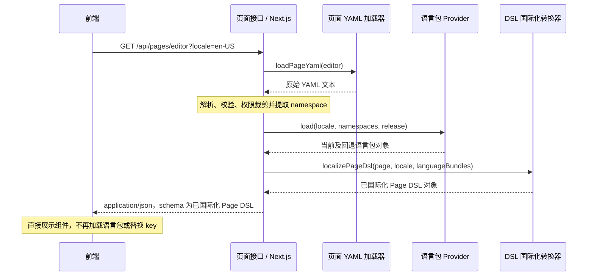
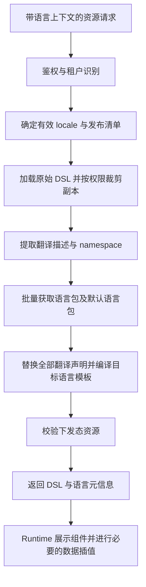

# Pactor YAML 国际化设计方案

日期：2026-10-22

状态：设计提案；本文中的新增 DSL 字段、接口和解析器尚未实现。

范围：YAML 页面、组件、布局、菜单及 Next.js 服务端资源下发。

## 1. 设计结论

采用 **三种声明方式、双语言包来源、服务端统一转换、前端展示 JSON DSL** 的国际化方案：

1. 组件属性支持内联多语言描述，适合局部、一次性文案。
2. 组件属性支持引用独立语言包的 key，作为正式业务的主要写法。语言包统一使用 YAML 定义；后端维护的 YAML 经解析后由 API 返回 JSON，Next.js 本地 YAML 则在服务端读取并解析为相同结构。
3. 负责返回资源的服务端读取页面 YAML、按请求语言加载语言包，完成翻译描述和 key 的替换，向前端返回已经本地化的 DSL JSON。
4. 渲染服务通过统一 Provider 同时支持读取 Next.js 本地语言包、调用后端语言包 API，以及通过 Next.js 语言包接口读取数据。浏览器正常展示链路不承担语言包加载或 key 查找。
5. 语言选择、词条版本和缓存上下文贯穿整个资源加载链，避免切换语言后出现旧文案。

声明方式明确分为：**属性内联多语言、属性引用语言包、bindings 路径绑定替换**。前两种直接修改属性的值，第三种保留原字段的默认文案，在页面级单独声明替换关系。语言包位于 Next.js 本地还是后端 API，是独立的来源配置，不增加新的声明方式。

“服务端完成国际化”在这里指 DSL 文案转换，不等同于页面已经生成 HTML。当前 Next.js 示例通过接口向浏览器提供 DSL，仍由 Pactor Runtime 渲染。

服务端完成语言选择、词条查找和模板选择；依赖后续交互的参数，可以转换为目标语言的安全文本模板，在前端仅进行数据插值。若连参数插值也要求完全由服务端完成，则交互后重新请求相应页面或片段。兼容旧版客户端 `t` 的模式单独保留，不作为本方案默认返回协议。

## 2. 仓库现状与约束

本次检查时 `docs/` 为空，以下判断以现有源码为依据。

| 位置 | 已有能力 | 本方案需要补充 |
| --- | --- | --- |
| `packages/core/src/i18n.ts` | `createI18nContext`、扁平或按语言分组的 messages、`{{name}}` 插值、默认语言回退 | 显式命中结果、统一回退策略、消息格式适配接口 |
| `packages/runtime/src/context/scope.ts` | 表达式作用域提供 `locale` 和 `t` | 保留现有 `${t('key', params)}` 用法 |
| `packages/runtime/src/context/i18n-context.ts` | `useI18n`、内置 `pactor.*` 中英文词条 | 与服务端有效语言一致，保留内置文案兜底 |
| `packages/app/src/application.ts` | 从 options / 持久化 / bootstrap / 浏览器选择语言；`setLocale` 更新词条并触发运行时重建 | 服务端转换模式下先协商语言，再重取所有本地化资源 |
| `packages/schema/src/schemas/dsl-node.ts` | 组件 `props` 为对象；节点顶层拒绝未知字段 | 定义可本地化属性值及其语义校验 |
| `packages/schema/src/schemas/page-dsl.ts` | 页面根字段严格限制，`page.title` 为字符串 | 增加作者态 i18n 配置；明确作者态和下发态区别 |
| `starters/next-app-starter/src/server/sitemap.ts` | 启动时读取共享 YAML，按会话裁剪 sitemap 和懒加载页面 | 在裁剪后的副本上做国际化，不能原地修改共享模板 |
| `packages/app/src/sitemap/loader.ts` | 页面缓存键为 `id@version` | 加入 locale、语言包版本和会话隔离 |
| `packages/runtime/src/datasource/dsl-source-resolver.ts` | 动态 DSL 引用以引用内容缓存 | 语言上下文变化时重建或清空缓存 |

当前 `t` 优先查当前语言，再查扁平 messages，再查默认语言，最终返回 key。它没有 ICU 复数解析能力；本文提出的增强不能视为现有功能。

## 3. 备选方案与取舍

| 方案 | 优点 | 局限 | 适用场景 |
| --- | --- | --- | --- |
| A：全部在组件中内联多语言 | 作者上下文完整，无需额外词条维护 | 页面膨胀、重复翻译多、统一审校困难 | 原型、小型页面、独立模块 |
| B：全部引用语言包，服务端转换 | 客户端负担小、翻译集中管理 | 不保留组件内联写法，切换语言需重取 DSL | 语言平台集中管理的页面 |
| C：内联与语言包统一建模，双 Provider 加服务端转换 | 两种来源可切换，前端统一消费已本地化 JSON | 需要转换器、动态文本模板协议和资源版本管理 | **推荐，作为框架通用方案** |

不建议对 YAML 原始文本执行正则替换，也不建议把所有字符串都当作翻译 key。必须在 YAML 解析后，对显式标记的值进行结构化转换，防止误改权限码、URL、枚举和表达式。

## 4. YAML 作者协议

### 4.0 三种多语言声明方式总览

`bindings` 是第三种声明替换关系的方式：**保留字段原有默认文案，通过路径找到该字段，再使用当前请求语言的译文覆盖它。** 它不负责设置或切换 `defaultLocale`，也不是额外的翻译来源。

| 方式 | 文案或替换关系在哪里定义 | 原属性的写法 | 是否需要独立语言包 | 适用场景 |
| --- | --- | --- | --- | --- |
| 一：属性内联多语言 | 属性的 `$i18n.messages` 中列出各语言文案 | 原字符串改为翻译对象 | 不需要 | 少量、局部且不复用的组件文案 |
| 二：属性引用语言包 | 属性的 `$i18n.key` 引用独立词条 | 原字符串改为翻译对象 | 需要 | 新建业务组件，推荐作为主要写法 |
| 三：bindings 路径绑定替换 | 页面 `i18n.bindings` 指定目标路径和翻译描述 | 保留原字符串，如 `text: 保存` | 使用 key 时需要；使用 messages 时不需要 | 现有 YAML 渐进改造、必须保持字符串的元信息字段 |

三种方式的服务端处理结果相同：当前请求为 `en-US` 时，最终组件属性都是 `text: "Save"`。`bindings` 可以覆盖 `page.title`，也可以覆盖注册过的组件展示字段，例如 `/body/props/text`；不限制为页面标题。

#### 方式一：属性内联多语言

```yaml
body:
  type: Button
  props:
    text:
      $i18n:
        messages:
          zh-CN: 保存
          en-US: Save
        fallback: 保存
```

适合文案直接跟随组件维护，不访问独立语言包。

#### 方式二：属性引用语言包

```yaml
i18n:
  namespaces: [common]
body:
  type: Button
  props:
    text:
      $i18n:
        key: common.save
        fallback: 保存
```

语言包分别定义 `common.save: 保存` 和 `common.save: Save`。服务端可以从 Next.js 本地 YAML 或后端返回的 JSON 获取这些词条，组件写法不变。

#### 方式三：bindings 保留默认文案并按路径替换

```yaml
page:
  id: editor
  title: 编辑页面
i18n:
  namespaces: [common, editor]
  bindings:
    /page/title:
      key: editor.page.title
      fallback: 编辑页面
    /body/props/text:
      key: common.save
      fallback: 保存
body:
  type: Button
  props:
    text: 保存
```

这里的 `/body/props/text` 是 JSON Pointer，表示找到 `body.props.text`。假设英文包中 `common.save` 为 `Save`、`editor.page.title` 为 `Edit page`，服务端返回的 DSL 内容为：

```json
{
  "page": {"id": "editor", "title": "Edit page"},
  "body": {"type": "Button", "props": {"text": "Save"}}
}
```

以上为展示声明差异的片段，实际资源仍需要完整的 `dsl` 及 envelope 字段。下发时已经移除 `i18n.bindings`，前端无需处理路径替换。

`bindings` 的值也允许使用内联消息，不一定引用语言包：

```yaml
i18n:
  bindings:
    /body/props/text:
      messages:
        zh-CN: 保存
        en-US: Save
      fallback: 保存
```

这表示“路径绑定 + 内联消息”。路径决定替换哪个字段，`key` 或 `messages` 决定译文来源，两者是不同维度。

#### 默认文案、默认语言与回退的区别

- `text: 保存`：原字段默认文案，是作者态内容，不决定当前语言。
- `defaultLocale: zh-CN`：应用的默认及回退语言，由请求解析与词条回退规则使用；`bindings` 不修改它。
- `fallback: 保存`：当前语言和回退语言均无可用译文时的兜底文案。
- `bindings`：定位目标字段并应用翻译的声明；即使本次请求恰好是默认语言，也按相同词条查找规则处理。

对 `bindings`，显式提供 fallback 时采用该值；未提供时，把目标字段原始字符串作为该描述的隐式 fallback。该隐式值只在词条回退失败后使用，不压过 defaultLocale 词条。两种属性内声明方式则没有可保留的原字符串，按各自 fallback 处理。

同一页面可以在不同字段混用三种方式；同一字段只能选择一种，禁止属性 `$i18n` 与 bindings 重复声明。新组件优先选择方式二，旧字段逐步改造或元信息字段选择方式三，少量一次性文案选择方式一。

### 4.1 统一的可翻译属性值

普通字符串保持原义。需要国际化时，属性值使用带 `$i18n` 的对象：

```yaml
# 内联定义：在组件属性中直接声明多语言
type: Button
props:
  text:
    $i18n:
      messages:
        zh-CN: 保存
        en-US: Save
      fallback: 保存
```

```yaml
# 独立语言包：属性通过 key 引用词条
type: Input
props:
  name: username
  label:
    $i18n:
      key: user.form.username
      fallback: 用户名
  placeholder:
    $i18n:
      key: user.form.usernamePlaceholder
      fallback: 请输入用户名
```

新组件优先把国际化信息放在具体属性值上；需要保留原属性字符串时，使用第 4.0 节明确支持的页面级 bindings。另不引入节点级 `i18n: {text: ...}` 平行映射，避免出现第四套声明规则。

语法约束：

- `$i18n` 包装对象不允许其他同级字段。
- 描述内 `key` 与 `messages` 必须且只能出现一个；不得在同一描述中混用。
- `key` 为完整稳定键名，不解析表达式；保留 `pactor.*` 作为框架词条前缀。
- `messages` 是 locale 到字符串的映射，禁止对象嵌套。
- `params` 为参数对象；第一阶段只允许标量或受控表达式，不允许函数、任意代码或嵌套翻译描述。
- `fallback` 为可选字符串，与词条使用相同的参数格式；对关键操作文案建议必填。
- 不支持 `${...}` 的字段不能通过 `$i18n` 获得表达式执行能力。
- `$i18n` 为 DSL 作者协议保留标识；业务数据及普通对象中的同名字段不触发解析。

### 4.2 页面声明与语言包

```yaml
dsl: "1.0"
page:
  id: user-list
  title: 用户管理
i18n:
  namespaces: [common, user]
  bindings:
    /page/title:
      key: user.page.title
      fallback: 用户管理
body:
  type: Button
  props:
    text:
      $i18n:
        key: common.save
        fallback: 保存
```

`i18n` 是拟新增的页面作者态字段，当前 Schema 不接受该字段。`namespaces` 是语言包分组，不是自动拼接 key 的前缀；`common.save` 始终是完整键名。

方式三使用 `i18n.bindings`，键为 JSON Pointer，值为上述翻译描述（直接写 `key` 或 `messages`，不再包 `$i18n`）。第一阶段只允许注册过的展示字段路径，且目标必须为字符串；禁止绑定 `/state`、请求参数、权限、标识和路由。目标不存在、路径重复、目标非字符串或已经是 `$i18n` 对象时，发布校验失败。编译器先定位字段并保存其原文作为可选的隐式 fallback，再按统一规则翻译；编译后移除作者态 `i18n` 字段。

JSON Pointer 中数组元素使用具体下标，如 `/body/children/0/props/text`，首期不支持通配符；属性名中的 `~` 和 `/` 分别按 `~0`、`~1` 转义。组件重排可能改变数组路径，发布时必须验证绑定位置；对频繁调整的组件树优先使用属性内声明。

独立语言包示例：

```yaml
# locales/zh-CN/user.yaml
user.page.title: 用户管理
user.form.username: 用户名
user.form.usernamePlaceholder: 请输入用户名
user.greeting: "你好，{{name}}"
user.selectedCount: "已选择 {{count}} 项"
```

```yaml
# locales/en-US/user.yaml
user.page.title: Users
user.form.username: Username
user.form.usernamePlaceholder: Enter username
user.greeting: "Hello, {{name}}"
user.selectedCount: "Selected: {{count}}"
```

远程模式由语言资源服务负责 YAML 解析、重复键检查和发布，渲染服务接收校验后的 JSON；本地模式由 Next.js 的 YAML Provider 完成同样的读取和校验。两者输出相同的规范化语言包。远程翻译文件可独立发布，本地文件默认随应用部署，两者都通过发布清单绑定兼容版本。

**定义格式与接口格式分开约定：语言包的作者态为 YAML，语言包 API 的传输格式固定为 JSON。** 后端负责将 YAML 解析为对象，再包装成第 6.1 节的响应；接口不返回 YAML 原文，也不在 JSON 中嵌入待解析的 YAML 字符串。Next.js 调用后端语言包 API 时只解析并校验 JSON，不再次执行 YAML 解析。

### 4.3 参数与动态翻译

服务端可确定的参数允许直接展开，例如固定产品名。引用 `${state.selectedCount}`、`${row.name}`、`${event.value}`、异步 `data` 的参数必须延迟到相应作用域存在时求值：

```yaml
type: Text
props:
  text:
    $i18n:
      key: user.selectedCount
      params:
        count: ${state.selectedCount}
      fallback: "已选择 {{count}} 项"
```

服务端先选出目标语言模板，例如 `Selected: {{count}}`，再将描述编译成纯数据的已本地化文本模板：

```json
{
  "$localizedText": {
    "template": "Selected: {{count}}",
    "params": {"count": "${state.selectedCount}"}
  }
}
```

这是拟新增的下发态值类型，只出现在注册的文本属性中；不包含翻译 key、其他语言或语言包引用。Runtime 属性解析时只计算当前 scope 中的参数并插入已选模板，之后给组件普通字符串。它不选择语言、不获取词条、不再次执行模板文本。参数均为字面量时，服务端直接输出最终字符串，不保留该包装。要求纯字符串下发的应用可关闭此能力，动态场景改为请求服务端片段重新转换。

已有写法继续支持：

```yaml
type: Text
props:
  text: "${t('user.selectedCount', {count: state.selectedCount})}"
```

新页面首选结构化描述。旧 `${t(...)}` 属于兼容入口：服务端转换模式下仅支持整个属性为单个 t 调用、key 为字符串字面量、params 为受支持对象的形式，通过 AST 编译为字符串或 `$localizedText`。嵌套调用、混合逻辑或动态 key 不在首期编译范围，发布检查报错，要求改为结构化描述；不得静默把未解析的 t 下发给前端。旧版纯客户端模式可继续保留原有 t 行为，但不得与默认服务端协议混用。

### 4.4 转换范围

组件通过能力元数据注册可翻译字段，例如：

| 对象 | 可翻译示例 | 不转换示例 |
| --- | --- | --- |
| 组件 props | `text`、`label`、`placeholder`、`description`、`ariaLabel` | `name`、`value`、`variant`、`className` |
| 嵌套展示配置 | `columns[*].title`、`options[*].label`、`rules[*].message` | `dataIndex`、选项 value、校验表达式 |
| 动作参数 | 注册动作的 `message.params.text`、确认框标题 | action 名、请求 URL/body、权限码 |
| 页面与应用元信息 | 页面 title、菜单 label、应用展示名 | page.id、path、resource id、permission |
| 动态片段 | 子组件和命名组件中的上述字段 | datasource 原始业务记录 |

实际字段名以组件/动作契约为准。编译器沿 DSL 结构遍历子节点、命名组件、布局、内联页面和已注册的展示配置；不对所有对象做无条件递归替换。不支持的字段出现 `$i18n` 时应报错，避免静默渲染对象。

## 5. 语言识别与一致性

应用统一配置支持的语言，例如 `zh-CN`、`en-US`，默认 `zh-CN`。语言不是国家：币种、时区、租户和地理区域应独立配置。

核心规则是：**先使用显式指定的语言；没有显式指定时，再进入默认语言解析链。** 不允许在使用了显式语言后，又被系统语言或应用默认值覆盖。语言包缺失属于词条回退问题，不能反向改变当前请求的有效 locale。

### 5.1 语言来源与默认优先级

| 层级 | 来源 | 获取方式 | 定位与处理 |
| --- | --- | --- | --- |
| 显式 1 | URL 语言 | 路径 `/en-US/users` 或查询参数 `?locale=en-US` | 当前访问明确指定，优先级最高；路径与查询参数同时存在且规范化后不同，返回 400 |
| 显式 2 | 语言 Cookie | `locale=en-US` | 用户主动选择或账号设置完成后写入的持久化偏好；当前 URL 语言可以覆盖 |
| 默认 1 | 浏览器/系统语言偏好 | 服务端读取 `Accept-Language`；纯客户端可读取 `navigator.languages` | 仅在没有显式指定时参与协商；可配置关闭 |
| 默认 2 | 应用默认语言 | 服务端配置 `defaultLocale` | 协商关闭、缺失或未命中时使用，必须在支持列表内 |

统一使用通用 Cookie 名 `locale`，不带框架或产品前缀。账号语言偏好设置完成后写入该 Cookie，请求解析器直接从 Cookie 获取，不再额外读取 `user.locale`，也不将账号偏好列为独立来源。若账号系统需要跨设备同步，应在其登录或偏好同步流程中更新 Cookie，再由后续请求使用。优先级属于应用级配置，不允许不同接口自行调整。

这里的“系统语言”指浏览器暴露的用户语言偏好，不能保证等同于操作系统设置。服务端不能读取用户设备设置，也不能将 Next.js 进程所在机器的语言当作请求语言。

提供两种默认策略，显式语言的优先级完全相同：

- `defaultStrategy: system`（推荐）：无显式指定 → 浏览器语言协商 → 应用默认语言。
- `defaultStrategy: application`：无显式指定 → 直接使用应用默认语言，适合要求统一初始语言的后台系统。

原先可能使用的 `options.locale` 在本模式中作为前端显式请求值传入，不再作为能够压过 URL 的固定配置。确需只支持一种语言的应用，直接将 `supportedLocales` 配为单个语言，其他显式语言按不支持处理。

### 5.2 前端获取与传递

前端不需要每次请求重新检测语言。初始化时选择候选语言，首次响应后固定使用服务端返回的有效 locale：

1. 读取当前页面 URL 的语言；调用方显式传入的 locale 通过资源请求的 `?locale=` 传递，页面 URL 已有语言时以页面 URL 为准。
2. 没有上述值时，让服务端根据 `locale` Cookie 和默认策略解析。SSR 使用请求中可见的信息，不额外等待浏览器检测。
3. 对纯客户端、无服务端首屏的场景，若服务端无法取得浏览器语言，可在默认协商分支读取 `navigator.languages`，按支持列表匹配；不得让它覆盖 URL、调用方配置或用户偏好。
4. 接收 `localization.locale` 后，将该值写入当前应用请求上下文，后续 sitemap、页面、片段和相关展示 API 均使用同一值。

请求传播约定：同源与跨源场景统一使用 `?locale=`；已有 locale 查询参数时替换，不能重复追加。例如 `/api/pages/user-list?locale=en-US`。不定义或使用自定义语言请求头；标准 `Accept-Language` 仅参与默认协商。

页面地址的 `/en-US/...` 不会自动出现在 `/api/pages/...` 的请求路径中，前端必须显式传播语言。Cookie 在满足域、路径及凭据条件时才会随请求发送，因此跨域资源加载不能只依赖 Cookie。

现有 localStorage 偏好是一次性迁移数据，不增加独立优先级：仅在没有当前 URL/调用方指定语言且尚未迁移的纯客户端启动中读取，通过偏好保存接口校验并写入 `locale` Cookie，再停用旧 localStorage 解析。已有有效 `locale` Cookie 时保留 Cookie，不被旧存储覆盖；不要把未经 Cookie 校验的旧存储值直接升级为当前请求的 URL 语言。SSR 请求无法读取 localStorage，不能在 hydration 后以其覆盖首屏语言。

### 5.3 Next.js 统一请求解析器

新增服务端 `resolveRequestLocale` 职责，sitemap、page、fragment 接口共享；SSR 的 layout/page 将路由参数、请求头和 Cookie 适配成相同输入。以下为协议伪代码，不是已存在的导出函数：

```ts
type LocaleSource =
  | 'url-path' | 'url-query'
  | 'cookie' | 'accept-language' | 'application-default';

type ResolvedRequestLocale = {
  locale: string;
  source: LocaleSource;
  explicit: boolean;
};

// 输入：路径/查询语言、解析后的 locale Cookie、Accept-Language，
// 以及应用支持列表和默认策略；不读取账号语言字段或自定义语言请求头。
// 输出：唯一有效 locale 及来源；不执行翻译，也不主动写 Cookie。
```

解析步骤必须固定：

1. 校验服务端配置：`supportedLocales` 非空，`defaultLocale` 属于支持列表，别名映射没有冲突。
2. 提取路径和查询语言，规范化后检测冲突；重复 `locale` 参数返回 400，防止不同层采用不同值。
3. 使用 URL 直接指定值。非法、空值或不支持时返回 `INVALID_LOCALE` / `UNSUPPORTED_LOCALE`，不能悄悄退回默认值；Cookie 和系统语言不得改变有效 URL 语言。
4. 没有直接指定值时，检查 `locale` Cookie；合法且受支持则返回。失效或过期偏好忽略并记录诊断，继续默认解析链；不因旧 Cookie 使页面永久无法访问。
5. 仍未命中且策略为 `system` 时，按 `Accept-Language` 的 q 权重匹配支持列表，忽略 q=0、非法项和无效权重；权重相同按出现顺序，`*` 使用应用默认语言。
6. 协商未命中或策略为 `application` 时返回应用 `defaultLocale`。

语言标识按标准 locale 格式规范化，并经支持列表验证。不要简单把 `en` 拼成 `en-US`；别名由应用显式配置，例如 `en → en-US`。语言级匹配存在多个候选时，使用应用配置的语言级默认映射，不依赖对象遍历顺序。

客户端和服务端复用同一份 locale 配置与匹配规则，浏览器只做候选选择，服务端最终校验。不得根据未校验的语言输入直接拼接文件路径或外部接口地址。

### 5.4 响应、持久化与一致性

资源响应的 `localization` 增加 `source` 和 `explicit`，便于定位语言来源；`Content-Language` 返回实际有效语言。示例：

```json
{
  "localization": {
    "locale": "en-US",
    "defaultLocale": "zh-CN",
    "source": "url-query",
    "explicit": true,
    "release": "rel-20261022-01"
  }
}
```

`source` 表示本次请求的直接命中来源：Cookie 选出的语言被前端传播为下次查询参数后，下次来源为 `url-query`；来源变化不影响有效语言或词条缓存键。

用户主动选择“记住语言”或保存账号语言设置后，由服务端写入或更新 `locale` Cookie；不因浏览器自动协商或访问分享链接而写入偏好。生产环境使用 HTTPS、`Secure`、`SameSite=Lax`，`Path` 按应用范围设置；客户端无需读取时可设 `HttpOnly`，有效期由应用配置。相同域下多个应用通过 Path 划分或约定共享，避免同名 Cookie 在重叠作用域中产生歧义。跨站 Cookie 另按部署条件配置，优先通过显式请求语言降低依赖。

语言切换时先用目标 locale 请求并完成资源校验，再提交界面与偏好；失败时保持原偏好。可提供专用偏好保存接口，用户 id 从会话获取，不能由请求体指定其他用户。URL 已有旧语言时也需同步更新，否则后续页面刷新仍会按 URL 选择旧语言。

`locale` 是本次请求语言，`defaultLocale` 是应用回退语言，两者不混用。服务端返回的有效 locale 成为当前界面的权威值，SSR 与客户端首次渲染一致；后续请求不得独立用系统语言重新协商。

### 5.5 解析示例

假设支持 `zh-CN`、`en-US`，默认 `zh-CN`，别名 `en → en-US`：

| 输入 | 策略 | 结果 |
| --- | --- | --- |
| URL `?locale=en-US`，Cookie `zh-CN`，系统 `zh-CN` | 任意 | `en-US`，显式 URL 优先 |
| 无 URL，Cookie `locale=en-US`，系统 `zh-CN` | 任意 | `en-US`，用户偏好优先 |
| 账号语言设置为 `en-US` 并已写入 `locale=en-US`，无 URL | 任意 | `en-US`，来源为 Cookie，不再读取账号字段 |
| 无显式语言，`Accept-Language: en;q=0.9,zh-CN;q=0.8` | `system` | `en-US`，协商后按别名匹配 |
| 无显式语言，系统偏好 `en-US` | `application` | `zh-CN`，直接采用应用默认 |
| 无显式语言，系统偏好仅 `fr-FR` | `system` | `zh-CN`，支持列表未命中 |
| 显式 `?locale=fr-FR` | 任意 | 400 `UNSUPPORTED_LOCALE` |
| 旧 Cookie 为 `fr-FR`，无其他偏好，系统 `en-US` | `system` | 忽略失效 Cookie，采用 `en-US` |
| 路径 `/en-US/users`，查询 `?locale=zh-CN` | 任意 | 400 `LOCALE_CONFLICT` |

## 6. 服务端处理流程

### 调用约定：加载 YAML，将语言包传入转换函数，返回 Page DSL JSON

**加载函数返回的 YAML 是服务端内部输入；服务端调用转换函数时传入语言包；转换函数的输出已经是国际化完成的 Page DSL JSON，随后直接作为页面接口结果返回前端。** 不存在先把原始 YAML 返回前端、再让前端套语言包的步骤，也不需要把翻译结果重新序列化为 YAML。

完整过程按一次页面请求执行：

1. 前端请求 `/api/pages/editor?locale=en-US`；服务端按第 5 节解析有效语言。
2. 服务端调用页面加载器，从本地文件或后端接口取得原始页面 YAML 文本。
3. 服务端解析 YAML 并校验作者态结构，按权限裁剪，提取该页需要的 namespace。
4. 调用已配置的语言包 Provider，取得当前语言和必要回退语言的 JSON 对象：本地 YAML 由 Next.js 解析，后端语言包 API 则直接返回 JSON。
5. 将解析后的页面、`locale`、`defaultLocale` 和语言包对象显式传入转换函数。转换函数统一处理内联 messages、key 引用和 bindings，替换字段值并移除作者态声明。
6. 校验转换结果为下发态 Page DSL；组装第 6.2 节页面资源 envelope，通过 `Response.json` 返回。
7. 前端从响应的 `schema` 取得已经国际化的 Page DSL，交给组件 Runtime 展示。



#### 转换函数如何接收语言包

建议将网络/文件加载和纯转换分开，以下仅为设计签名及调用伪代码，尚未实现：

```ts
// 独立纯转换入口：语言包作为参数显式传入，不在遍历组件时自行请求。
localizePageDsl({
  page: authorizedPage, // 原始 YAML 解析并裁剪后的作者态对象
  locale: 'en-US',
  defaultLocale: 'zh-CN',
  languageBundles: {
    current: englishBundleSet,
    fallbacks: [chineseBundleSet],
  },
}); // 返回已国际化的 Page DSL 对象，不返回 YAML 文本

// 页面接口的编排伪代码：
const yamlText = await pageLoader.loadPageYaml(pageId);
const sourcePage = parseAndValidatePageYaml(yamlText);
const authorizedPage = prunePageForSession(sourcePage, session);
const namespaces = collectNamespaces(authorizedPage);
const languageBundles = await loadLocaleChainBundles({
  provider: messageProvider, // yaml 或 api Provider
  locale, defaultLocale, namespaces, release,
});
const pageDsl = localizePageDsl({
  page: authorizedPage, locale, defaultLocale, languageBundles,
});
validateLocalizedPageDsl(pageDsl);
return Response.json(toPageResource(pageDsl, localization));
```

`localizeYamlResource` 是上述步骤的服务端编排入口，负责加载、解析、语言包获取和校验；`localizePageDsl` 是显式接收语言包的纯转换入口。若调用方已经取得 YAML 和语言包，可直接解析后调用纯转换入口，避免重复加载。两种入口复用同一转换逻辑。

#### 同一次调用的输入与返回示例

加载器返回的 YAML：

```yaml
dsl: "1.0"
page:
  id: editor
  title: 编辑页面
i18n:
  namespaces: [editor, common]
  bindings:
    /page/title:
      key: editor.page.title
body:
  type: Button
  props:
    text:
      $i18n:
        key: common.save
        fallback: 保存
```

传入转换器的当前语言包，其规范化 JSON 中包含：

```json
{
  "locale": "en-US",
  "messages": {
    "editor.page.title": "Edit page",
    "common.save": "Save"
  }
}
```

这里展示的是从第 6.1 节 bundles 中汇总出的词条视图，不改变语言包 API 的 envelope 契约。转换函数返回的 Page DSL 对象序列化后为：

```json
{
  "dsl": "1.0",
  "page": {"id": "editor", "title": "Edit page"},
  "body": {"type": "Button", "props": {"text": "Save"}}
}
```

页面接口将该对象放入 `schema` 后返回，完整 envelope 见第 6.2 节。因此“调用返回的 YAML 时传入语言包”具体指服务端拿到 YAML 后调用转换函数；页面接口返回当时，`schema` 就已经是上述英文 Page DSL JSON。

### 服务端内部处理职责



具体职责：

- `LocaleResolver`：只负责选择有效语言，不修改 DSL。
- `MessageProvider`：从 Next.js 本地 YAML 或语言包 API 读取发布后的词条，统一返回规范化语言包，不负责组件结构。
- `DslLocalizer`：根据字段注册信息转换 DSL，输出已本地化的新对象和缺失诊断；动态属性输出已选语言模板。
- Runtime：展示已本地化的 DSL，仅处理动态模板参数；现有 I18nContext 供框架内置文案及旧模式使用。

以上为拟新增职责，不代表已存在的导出 API。纯解析逻辑应独立于 Next.js，Next.js 仅作为请求、鉴权和接口适配层。

处理顺序必须是：作者态 Schema 校验 → 权限裁剪 → 翻译 → 下发态 Schema 校验。共享原始 DSL 保持不可变，避免并发请求中的中英文或租户数据相互污染。

语言包可并行批量获取；不得在每个组件解析时发出网络请求。Next.js 本地文件必须通过内部 Provider 直接读取，不在同一进程内绕 HTTP 请求自己；外部渲染服务可调用 Next.js 暴露的语言包 API。

### 6.0 双来源语言包与 YAML 转换支持

#### 6.0.1 区分页面来源、语言包来源和转换执行位置

页面 YAML 从哪里取得，与语言包放在哪里相互独立：

本节所称“API 返回原始 YAML”仅描述可选的页面 DSL 来源，不适用于语言包接口。语言包接口始终返回 JSON，底层定义文件始终为 YAML。

| 页面来源 | 语言包来源 | 执行方式 |
| --- | --- | --- |
| Next.js 本地页面 YAML | Next.js 本地语言 YAML | Next.js 读取两类文件，转换为本地化 DSL JSON 返回 |
| Next.js 本地页面 YAML | 后端语言包 API | Next.js 读取页面，调用 API 获取语言包，转换后返回 |
| 后端 API 返回原始 YAML | Next.js 本地语言 YAML | Next.js 获取原始 YAML，读取本地语言包，转换后返回 |
| 后端 API 返回原始 YAML | 后端语言包 API | Next.js 分别获取页面与语言包，转换后返回 |
| 后端负责页面转换 | 后端语言包或 Next.js 语言包 API | 后端解析原始 YAML，读取语言包并转换，直接或经 Next.js 透传本地化 JSON |

一个资源只由一个服务端承担转换责任。上游已返回完成本地化的 DSL JSON 时，Next.js 核验 locale/release 后透传；不得再次解析 key。上游返回 YAML 或未转换的作者态 JSON 时，Next.js 执行转换。接口必须显式区分原始与已转换资源，不能仅凭“JSON 格式”认定已翻译。

建议原始资源使用 `representation: source`，载荷包含 `contentType`（`application/yaml` 或 `application/json`）及 `content`；完成转换的资源使用 `representation: localized`、`schema` 和 `localization`。这些都是拟新增的服务间协议字段，浏览器只接受 localized 资源。

#### 6.0.2 Next.js 本地目录与读取职责

```text
src/server/
  yaml/pages/user-list.page.yaml
  i18n/
    manifest.json
    locales/zh-CN/common.yaml
    locales/zh-CN/user.yaml
    locales/en-US/common.yaml
    locales/en-US/user.yaml
    yaml-message-provider.ts
    api-message-provider.ts
    localize-yaml-resource.ts
```

以上文件是建议结构。语言 YAML 的内容沿用第 4.2 节扁平键值格式，不能放入 `public/` 或由客户端模块导入。`manifest.json` 记录应用、release、语言、namespace、文件相对路径和内容版本；文件路径只从受信任清单取得。

`YamlMessageProvider` 必须提供：

1. 按应用、租户（如适用）、release、locale 和 namespace 定位文件并异步读取；禁止用户输入直接拼接路径。
2. 严格解析 YAML，遇到语法错误、重复 key、自定义标签、非字符串词条或超出大小/别名展开限制时拒绝该包。
3. 输出与后端 API 相同的 `MessageBundleSet`，包含 format、版本和 messages，并应用相同的键名及参数校验。
4. 生产环境按清单版本缓存只读结果；开发环境按文件变动失效，避免修改文案后继续读旧缓存。
5. 在构建/部署时包含 YAML 及 manifest；使用文件系统的路由选择 Node.js 运行环境。无法使用文件系统的部署形态需在构建时将 YAML 转为服务端 JSON 模块，通过同一 Provider 契约加载。

`localizeYamlResource` 作为 Next.js 服务端公共转换入口，依次完成：加载页面文本 → YAML 严格解析 → 作者态校验 → 会话裁剪 → 提取 namespace → Provider 批量加载 → 翻译及模板编译 → 下发态校验 → 返回 JSON 对象。由 Route Handler 使用 `Response.json` 输出；不返回 YAML 文本给浏览器，不把服务端渲染理解为生成 HTML。

#### 6.0.3 渲染服务统一 Provider 契约

以下为设计签名，尚未实现：

```ts
interface MessageProvider {
  load(input: {
    appId: string;
    tenantId?: string; // 来自服务端可信上下文
    locale: string;
    namespaces: string[];
    release: string;
  }): Promise<MessageBundleSet>;
}

// MessageBundleSet 为第 6.1 节响应结构；两类 Provider 输出完全相同。
// DslLocalizer 只依赖此接口，不根据来源实现两套替换逻辑。
```

两类 Provider 的解析边界：

| Provider | 输入 | 处理 | 输出 |
| --- | --- | --- | --- |
| `YamlMessageProvider` | Next.js 本地语言包 YAML 文件 | 读取文件、严格解析 YAML、校验并规范化 | `MessageBundleSet` 对象 |
| `ApiMessageProvider` | 后端或 Next.js 语言包 API 返回的 JSON | 校验响应状态和 Content-Type、解析 JSON、校验协议与版本 | 相同的 `MessageBundleSet` 对象 |

API 来源在提供方内部执行“YAML 定义 → 解析校验 → JSON 响应”；消费方不需要知道文件路径或 YAML 读取细节。API 若返回 YAML 或含 YAML 字符串的伪 JSON，按协议错误处理，不自动切换解析方式。

渲染服务至少支持以下配置，来源不由浏览器请求任意指定：

```yaml
# 方式一：Next.js 服务端本地文件
i18n:
  messageSource:
    type: yaml
    manifest: src/server/i18n/manifest.json
```

```yaml
# 方式二：语言包 API，可以指向后端，也可以指向 Next.js 的语言包接口
i18n:
  messageSource:
    type: api
    endpoint: https://language-service.example/v1/i18n/bundles
    credentialsRef: I18N_SERVICE_TOKEN
```

配置属于服务端应用配置，与第 4.2 节页面级 `i18n` 分开。`credentialsRef` 仅引用服务端配置，不下发密钥。首期允许应用整体选择来源，或由可信发布清单将不同 namespace 映射到两种 Provider；同一 namespace 在同一 release 中只有一个权威来源，不隐式覆盖合并。

#### 6.0.4 Next.js 语言包接口

Next.js 可提供 `GET /api/i18n/bundles`，参数与响应沿用第 6.1 节，内部调用 `YamlMessageProvider` 后序列化为 JSON，使用 `Content-Type: application/json`。这样其他渲染服务既能调用后端 API，也能通过 `ApiMessageProvider` 调用 Next.js 获取语言包；两者不影响后续页面 YAML 转换。

该接口供服务间读取词条；`/api/pages/[id]`、`/api/sitemap` 等展示接口返回已经转换的 JSON，二者职责不同。外部调用受服务身份和租户权限控制，仅返回批准发布的 namespace。浏览器展示不要求先请求该语言包接口。

### 6.1 语言包服务接口提案

后端使用第 4.2 节的 YAML 语言包作为定义来源，发布前完成严格解析及校验；接口固定返回下面的 JSON envelope，响应 `Content-Type: application/json`。Next.js 语言包接口使用完全相同的契约。

```http
GET /v1/i18n/bundles?appId=console&locale=en-US&namespaces=common,user&release=rel-20261022-01
Authorization: Bearer <server-credential>
```

```json
{
    "appId": "console",
  "locale": "en-US",
  "release": "rel-20261022-01",
  "format": "simple-v1",
  "bundles": {
    "common": {
      "version": "12",
      "messages": {"common.save": "Save"}
    },
    "user": {
      "version": "7",
      "messages": {"user.selectedCount": "Selected: {{count}}"}
    }
  }
}
```

租户身份从鉴权上下文获取；若接口需要 tenantId，服务端必须核验其归属。响应可使用 ETag / If-None-Match；304 时复用同一缓存键的已校验包。namespace 和 release 必须来自应用发布配置或已校验 DSL，不能接受任意远程 URL。

发布清单固定 DSL 版本与各语言 namespace 版本，避免多次请求拼出不同发布批次。缺失 namespace 返回明确错误，单个词条缺失进入回退流程；不同 namespace 不允许定义同一个完整 key。

### 6.2 下发资源协议提案

现有 page resource envelope 保持，新增 `localization` 元信息：

```json
{
  "id": "user-list",
  "resourceType": "page",
  "representation": "localized",
  "version": 8,
  "dslVersion": "1.0",
  "localization": {
    "locale": "en-US",
    "defaultLocale": "zh-CN",
    "source": "url-query",
    "explicit": true,
    "release": "rel-20261022-01",
    "bundleVersions": {"common": "12", "user": "7"}
  },
  "schema": {
    "dsl": "1.0",
    "page": {"id": "user-list", "title": "Users"},
    "body": {"type": "Button", "props": {"text": "Save"}}
  }
}
```

默认响应不包含 `localization.messages`、原始 `$i18n`、未解析翻译 key 或客户端 t 调用。静态文本是最终字符串；动态文本仅允许第 4.3 节的 `$localizedText`，语言选择已经完成。响应 envelope 增加 `representation: localized` 以标明状态。

bootstrap 适配层将 `localization.locale/defaultLocale` 映射到会话。框架内置 `pactor.*` 暂由现有 Provider 提供；它是组件内部文案的兼容机制，不改变业务 YAML 必须服务端转换的约定。若要求内置文案也由远程服务统一管理，可后续单独扩展，但不能让默认页面依赖浏览器读取语言包。

新增字段及动态描述需要资源类型、Schema 与 Runtime 同步支持。发布时升级对应 DSL/运行时能力版本，通过现有 `requires.runtime` 校验兼容性；示例中的 `dsl: "1.0"` 仅用于说明结构，不表示旧版 Runtime 能直接消费新增语法。

## 7. 动态参数和表达式边界

- 服务端只展开字面量参数。首期不在服务端执行任意 `${...}`，包括看似可用的用户或路由表达式。
- 翻译文本中的 `{{name}}` 由翻译器插值；DSL 中的 `${state.name}` 由表达式引擎求值，两者不得混为一种模板语法。
- 翻译结果作为最终文本值，**不得再次送入表达式引擎**。词条内容不得执行 `${...}`。
- 现有 `resolveDeep` 会递归解析普通对象，需要增加 `$localizedText` 分支，只求值 params，模板及插值结果不进入表达式引擎。作者态 `$i18n` 若意外进入默认客户端链路，应作为协议错误拒绝。
- 服务端替换后的静态文本若包含字面量 `${`，现有 Runtime 也可能将其当成表达式。首期发布校验应拒绝此类词条和 fallback，并对插值后的静态结果再次检查；后续需要展示该文本时，再引入受版本管理的纯文本标记协议。
- 参数值使用字符串或数字等标量，未知参数保留占位符并记录诊断；不能静默丢失。该行为与现有 core 插值器将缺失参数变成空字符串不同，需要通过新的目标语言模板插值路径实现，旧版 t 行为保持兼容。
- 默认按普通文本渲染。翻译值不能进入 HTML 执行路径；富文本应使用受控节点占位机制另行扩展。

日期、数字、金额使用共享格式化适配层，底层可使用 `Intl`。传递原始 number / ISO 日期，明确 locale、timeZone、currency；不得靠翻译字符串拼接日期或假设语言决定币种。

第一阶段采用现有 `{{name}}` 简单插值，语言包标记 `format: simple-v1`。复数、性别和复杂句式可在第二阶段增加 `icu-v1`；需引入经过验证的 ICU 解析器，在服务端与客户端使用同一版本。不能将 ICU 文案直接交给当前简单插值器。

## 8. 缺失、回退和失败策略

同一描述的固定查找顺序：

1. 当前有效 locale 的内联消息或语言包词条。
2. 显式配置的语言级回退，例如 `fr-CA → fr`；只访问已配置的语言。
3. 应用 defaultLocale 对应词条。
4. 描述的 fallback；bindings 未显式配置时使用绑定目标的原始字符串。
5. key；内联描述没有 key 时展示统一的缺失文案，并记录资源路径。

空字符串视为有效翻译，不触发回退。建议新增返回 `{found, value, resolvedLocale}` 的内部 lookup，不能只用 `translated === key` 判断命中，因为合法译文可能恰好等于 key。现有 `useI18n` 的判断需在兼容迁移中替换。

所有词条回退均在服务端执行，包括动态模板的选取；Runtime 收到的是已经完成回退的目标模板，不再次查找 key 或选择语言。本地 YAML 与 API Provider 使用同一查找规则。

API 超时不可用或本地语言 YAML 缺失/损坏时：优先使用相同来源、租户、应用、release 和语言的最近有效缓存；没有缓存则尝试已验证的默认语言包或描述 fallback。不能为了可用性跨租户、跨来源或混用不兼容发布版本。关键登录/操作文案无有效回退时，资源请求返回 503 和可识别错误码，前端显示内置可重试错误页。不得因 API 失败而隐式使用另一份本地词库，除非发布清单事先定义了等价镜像版本。

建议初始请求超时 2 秒，最多重试一次且受总请求预算限制；缓存过期宽限期默认 24 小时，可按应用调整。多实例缓存应具有统一版本来源，不能依赖每个进程恰好同时刷新。

## 9. 缓存、发布与语言切换

### 9.1 缓存键

| 缓存层 | 必须包含的维度 |
| --- | --- |
| 原始 YAML / DSL | 应用、资源 id、DSL 版本；租户私有模板另加 tenant |
| 语言包 | provider/sourceId、tenant、appId、locale、namespace、release、bundleVersion、format |
| 服务端本地化 DSL | 上述资源/语言版本、解析器版本；若已裁剪还需会话或权限指纹 |
| 客户端页面和片段 | 资源 id/version、locale、release、词条版本、会话代次 |

`id@version` 不足以区分同一页面的中英文。页面版本未变但词条版本变化时，也必须失效。会话变更、登出和权限变化时清空对应页面与片段缓存。

会话相关 sitemap/page 接口继续使用 `Cache-Control: no-store`；语言包缓存独立管理。只对确认可公开共享的语言包启用共享缓存，并明确选择 Next.js 的缓存策略，不能依赖框架默认值。[Next.js fetch 文档](https://nextjs.org/docs/app/api-reference/functions/fetch)说明了 `cache`、`revalidate` 的控制方式。

### 9.2 语言切换事务

当前 `setLocale` 只更新上下文，不能恢复已经被服务端替换成字符串的文案。服务端转换模式需要新增应用层异步切换编排：

1. 用户选择语言；存在未提交表单时提示保存或放弃，允许取消切换。
2. 使用目标 locale 获取 sitemap、当前页面及必需语言资源，生成新的请求代次。
3. 校验所有响应的 locale/release 一致，准备新菜单、布局、标题和页面上下文。
4. 全部成功后一次性替换界面，重建页面/片段缓存，同步 URL 中的语言；用户选择记住语言时再持久化偏好。
5. 丢弃旧代次的迟到响应；失败则保持原语言和原界面，提供重试。

首期采用应用资源重载并重建页面 Runtime；它会重置页面 DataStore 和未提交表单状态，必须按上述交互处理。保留表单状态、所有标签页和任意组件局部状态不作为首期承诺。现有 SPA 纯客户端翻译模式继续允许 `setLocale`。

语言切换后，同步更新文档 `lang` 和基于受支持语言配置的 `dir`，清理或重新构建旧标题标签页；所有后续懒加载、动态片段和必要的业务展示 API 都通过查询参数携带目标 locale。跨域部署时同步检查 Cookie 作用域、凭据和 CORS 配置，无需增加自定义语言请求头。

## 10. Next.js 接入位置

以下都是拟议改动，本文不修改运行代码：

| 接入点 | 改动 |
| --- | --- |
| `app/api/sitemap/route.ts` | 从请求和会话确定 locale，获取发布上下文，返回已本地化的菜单、布局和内联页面 |
| `app/api/pages/[id]/route.ts` | 沿用鉴权，接收相同 locale/release，返回转换后的 page resource |
| `src/server/sitemap.ts` | 保留原始只读模板，拆开会话裁剪与本地化两个步骤 |
| `src/server/i18n/*`（新增） | 本地 YAML Provider、API Provider、统一 YAML 转换入口和发布清单 |
| `app/api/i18n/bundles/route.ts`（新增） | 将 Next.js 本地语言包按统一协议提供给获授权的渲染服务 |
| 动态 DSL 服务接口 | 使用相同 Provider 和发布上下文，不能跳过翻译或忽略请求语言 |
| `packages/app/src/sitemap/*` | 传递语言上下文、校验 localized 资源、实现异步切换和缓存隔离 |
| `packages/runtime/src/utils/resolve.ts` | 在对应作用域填充已本地化模板参数，插值结果作为终值 |
| `packages/core` / `packages/schema` | 增加类型、校验和共享查找规则；区分作者态与下发态 |
| 脚手架和示例模板 | 同步当前 starter、`packages/create-app/templates/next-app` 及示例，防止生成项目缺少协议支持 |

后台应用优先使用 `?locale=` 加语言 cookie，避免立即改动现有 sitemap path。面向公开搜索的网站可选 `/[locale]/...`，但需同步调整路由、canonical、alternate 链接和 sitemap；不应仅为翻译后台组件而强制迁移路由。

Next.js 支持在服务端按语言加载字典；本方案把这一思路应用到 DSL 资源转换层，参考[官方国际化指南](https://nextjs.org/docs/app/guides/internationalization)。

## 11. 实施顺序

### 第一阶段：建立协议与服务端链路

支持 `$i18n.messages`、`$i18n.key`、简单 params/fallback、页面 bindings；实现作者态校验、字段注册、YamlMessageProvider、ApiMessageProvider、统一 YAML 转换入口和目标语言模板编译。打通本地/API 两类页面来源、两类语言包来源，以及 sitemap、懒加载页和动态片段。

交付双语言示例、Next.js 语言包接口、服务端返回已转换 JSON、动态参数响应交互、缺失诊断及语言维度缓存。静态属性为字符串，动态属性为已选语言的安全模板，不能残留 `$i18n` 或 t 调用；复杂复数格式不进入本阶段。

### 第二阶段：完善发布和应用切换

实现发布清单、语言包版本、ETag、批量加载、异步语言切换、迟到响应隔离，以及脚手架同步。补齐菜单、布局、动作提示、校验信息和内置组件文案的一致性。

### 第三阶段：翻译治理和语言扩展

按实际业务需要加入 ICU、RTL、日期/金额格式化、词条提取 CLI、翻译平台导入导出和覆盖率门禁。避免一次性引入完整翻译平台依赖。

## 12. 验收标准

| 场景 | 预期结果 |
| --- | --- |
| 同一按钮分别使用内联描述和语言包 key | `zh-CN` / `en-US` 下均显示正确文案 |
| 同一文本分别使用属性内联、属性引用及 bindings | 三种声明生成相同的本地化字段值，不改变请求 locale/defaultLocale |
| bindings 未配置 fallback，且所有语言词条均缺失 | 保留目标字段原始文案；显式 fallback 存在时采用显式值 |
| bindings 与属性内 `$i18n` 指向同一字段，或目标路径失效 | 发布检查报错，不以处理顺序决定覆盖结果 |
| 同一页面分别使用 Next.js YAML 和后端 API 语言包 | 对等语言包生成相同 DSL JSON，转换器不因来源分叉 |
| 后端使用 YAML 定义语言包并通过 API 提供 | API 返回规范 JSON 和 `application/json`，消费方只解析 JSON，不接收 YAML 原文或 YAML 字符串 |
| 后端 API 返回原始 YAML，Next.js 获取后转换 | 浏览器只收到已本地化 JSON，无 YAML 原文或未解析翻译声明 |
| 渲染服务通过 Next.js `/api/i18n/bundles` 读取语言包 | 与调用后端语言包 API 使用同一协议及 Provider 契约 |
| Next.js 语言 YAML 缺失、重复键、损坏或未打入部署产物 | 明确报错或执行受控回退，不返回带原始 key 的成功资源 |
| 上游返回已转换的 localized JSON | 校验 locale/release 后透传，不重复翻译 |
| 检查默认页面响应及浏览器网络请求 | 没有原始 `$i18n`、待查词条或客户端 t；无额外语言包请求 |
| 中英文请求同时转换同一个共享模板 | 结果隔离，原始模板没有被修改 |
| 菜单、布局、内联页、懒加载页和动态片段 | 使用相同有效语言与发布上下文 |
| 修改选择数量或行数据 | 动态文案随当前 scope 更新，不需要重取整份 DSL |
| 词条缺失、空字符串、译文恰好等于 key | 分别按明确回退规则、有效空译文、有效命中处理 |
| 包接口超时、304、namespace 缺失 | 分别按缓存/降级、复用校验缓存、明确诊断处理 |
| 语言包更新但 DSL 版本不变 | 词条版本使本地化缓存失效 |
| 切换语言时有旧页面请求在途 | 旧响应不能覆盖新界面 |
| 切换语言失败或用户取消 | 语言、菜单、表单和页面维持原状态 |
| 用户登出或切换租户 | 旧会话资源和私有词条不可复用 |
| 翻译文本含脚本、HTML 或 `${...}` | 文本不能执行代码；不支持的表达式样式在发布/转换时被拒绝 |
| 普通 label、URL、value、权限码不含翻译声明 | 保持原义，不能被自动替换 |
| 旧页面使用受支持的单个 `${t(...)}`，或完全没有国际化声明 | 前者服务端编译，后者普通渲染；不支持的 t 形态发布时报错 |
| SSR 或首屏请求 | 服务端有效 locale 与客户端首次渲染一致，无语言闪回 |
| URL、`locale` Cookie 和系统语言同时存在 | 按 URL → Cookie → 系统语言 → 应用默认解析，不被默认配置覆盖 |
| 账号语言设置保存完成 | 更新 `locale` Cookie，后续解析只读取 Cookie，不额外查询账号语言字段 |
| 没有显式语言 | `system` 策略先协商再回退，`application` 策略直接使用应用默认 |
| 语言来源缺失、非法、重复或冲突 | 按第 5 节区分直接指定错误、失效偏好和协商未命中 |
| `Accept-Language` 含 q=0、通配符或同权重语言 | 采用统一匹配规则，结果可重复且属于支持列表 |
| URL 带语言但页面/片段接口没有语言路径 | 请求加载器显式传播已确定的 locale，不能重新检测系统语言 |
| 浏览器自动协商或打开带语言的分享链接 | 不自动覆盖已保存的语言偏好 |

解析器以单元测试覆盖回退、转换范围和不可变性；资源接口以集成测试覆盖鉴权/语言/版本；语言切换以端到端测试覆盖未提交表单、失败回滚和竞态。监控至少记录 missing-key、包请求失败、回退次数、转换耗时和缓存命中，不记录敏感插值参数。

## 13. 评审建议

建议批准方案 C，明确属性引用语言包为主、组件内联为辅，bindings 用于保留默认文案的字段和渐进改造；三种声明统一转换，两种语言包来源通过统一 Provider 接入。无论原始 YAML 和语言包来自后端 API 还是 Next.js 本地文件，前端都消费已完成语言选择与词条替换的 DSL JSON；动态文案仅填充已选模板的参数。旧版客户端 t 仅作为独立兼容模式保留。

本文件仅为设计交付，尚未执行运行时代码变更或依赖安装。
