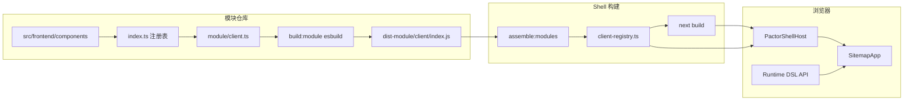

# InnoSpots Web Shell（`innospots-web-shell`）

基于 **Next.js App Router + Pactor** 的统一 Web 入口：在**构建期**装配多个 UI npm 模块（YAML DSL、扩展组件、静态资源），在**运行期**通过统一 DSL API 与 `PactorShellHost` 渲染业务页面。

> 整体架构与术语见 InnoSpots 前端模块化设计（Build-time Composition + Runtime DSL Loading）。UI 模块侧打包使用 Pactor CLI：`pnpm build:module`（`pactor module build`）/ `pnpm pack:module`（`pactor module pack`）。

**当前接入**：`pactor-apps` 下三个 tgz 模块 `general-app` / `data-analysis` / `product-center`（版本随 pack 递增，以 `package.json` 的 `file:` 引用为准）。业务 API 随 tgz 的 `server/index.mjs` 分发，由 Shell 的 `/api/modules/<moduleId>/*` 统一承接。导航统一定义在 `src/shell/sitemap.yaml`，模块启停与菜单接入模式（当前全部 `hidden`）在 `src/modules/module-list.json`。外壳能力（菜单 / 皮肤 / 布局、Runtime API、装配 CLI）来自 `@pactor-app/shell` 包（`packages/shell`），本工程为最薄宿主示范。

**默认业务应用**：`pactor-apps/general-app` 提供工作台 / 数据概览 / 系统管理（系统设置 / 字典管理 / 审计日志 / 角色管理 / 用户管理）+ 隐藏的角色详情；页面 DSL、组件、mock 数据与 i18n 语言包全部随模块交付，`web-shell` 只保留宿主骨架。演示登录 `admin / admin123`（`/api/auth/login` + cookie 会话，见下文「会话与登录」）。

## 宿主与模块边界

- **Shell（本工程）**：Next 路由骨架、AppShell / PactorShellHost、Runtime DSL API（bootstrap / pages / fragments / modules 分发）、会话占位、模块装配配置、基础皮肤与预置皮肤。
- **模块（`pactor-apps/*`）**：页面 DSL、自定义组件 / Actions、业务 API（server entry）、演示数据、i18n 语言包与可翻译字段；以 tgz 交付，`pactor.module.json` 声明 `id` / `basePath` / `apiPrefixes`。
- 装配器把模块页面按 `basePath` 拼成公开路径、把模块 API 挂到 `/api/modules/<moduleId>/*`；Shell 不复制任何业务页面或数据实现。

---

## 设计目标

本工程（Web Shell）与配套 UI npm 模块共同服务于 **多业务前端合一部署**，在保留 Pactor YAML 描述式页面的前提下，实现可版本化、可回滚的模块化交付。

### 业务与工程目标

| 编号 | 目标 | 说明 |
| --- | --- | --- |
| **G1** | 模块可独立开发与演示 | 各 UI 工程保留 `npm run dev` / `next build`；额外提供 `build:module` 产出 npm 包，不破坏原仓库工作流 |
| **G2** | Shell 统一装配与入口 | 通过 `npm install` + 配置启停模块，生成统一菜单、HTTP 路由与页面索引；对外仅一个 Next 服务 |
| **G3** | YAML DSL 免大规模改写 | 页面仍以 YAML 描述；不要求整站迁成 TSX 路由；复用现有 Pactor 渲染与扩展机制 |
| **G4** | 资源与扩展可被 Shell 消费 | 模块的 CSS、图片、字体、自定义组件、Actions 在构建期进入 Shell，运行期路径与注册关系确定 |
| **G5** | 可发布、可回滚、可审计 | 模块 SemVer + lockfile；构建产物可复现；装配失败则构建失败；升级通过重新构建 Shell 而非生产环境临时装包 |

### 非目标（一期不做）

| 编号 | 非目标 | 说明 |
| --- | --- | --- |
| **N1** | 浏览器运行时动态 `npm install` | 模块变更必须走构建与部署流水线 |
| **N2** | 把某工程的 `.next` 当插件嵌入另一 Next | 交付物是 DSL + client + assets，不是整应用产物 |
| **N3** | 模块独立热更新 JS 而不重建 Shell | V1 采用构建期装配；若未来需要再评估远程 DSL / Module Federation |

### 架构原则（一句话）

**Build-time Composition（构建期装配） + Runtime DSL Loading（运行期经 API 加载 DSL）**：默认不采用微前端 iframe、不在浏览器拼接未校验的模块路径。

---

## 设计要求

以下为 Shell 与 UI 模块**必须满足或推荐遵守**的约束，用于评审实现与 PR。

### 架构与边界

1. **单一 Web 进程**：生产环境仅一个 Next.js Shell 对外；模块不单独起生产 Next。
2. **显式模块清单**：只装配 `module-list.json` 中 `enabled: true` 的包，禁止运行时扫描整个 `node_modules`。
3. **双轨路由模型**：HTTP URL 由 Shell 路由索引决定；页面逻辑标识使用 `globalPageId = moduleId:pageId`，二者通过装配表映射，不把 YAML 文件路径暴露为公共 URL。
4. **适配层隔离**：Shell 通过 `@pactor-app/shell/client` 的 `PactorShellHost` 对接 Pactor 版本；业务模块不直接依赖 Shell 内部实现。
5. **Client 边界**：扩展组件与 Actions 经构建期生成的 `client-registry` **静态 import** 进入浏览器 Bundle；禁止把普通函数/组件经 Server Component props 序列化下发。

### 模块交付契约（npm 包）

1. **Manifest V1**：每个模块提供 `schemaVersion: "1"` 的 `manifest.json`（id、version、basePath、dslRoot、sitemap、assetsRoot、clientEntry、可选 serverEntry/apiPrefixes 等）。
2. **exports 显式**：至少 `./manifest`、`./client`；声明 server entry 时还需 `./server`；路径相对发布根（`dist-module`），禁止 `../` 逃逸。
3. **双流水线分离**：`next build`（独立应用）与 `build:module`（npm 交付）互不替代；`app/`、`.next/` 不得打入 `files` 发布目录。
4. **peer 单例**：React、React DOM、Pactor、Next 由 Shell 提供兼容版本；模块不得再初始化全局 Router 或覆盖 Shell 全局 Theme/Auth Context。
5. **sitemap 可合并**：模块内 `pages[].path` 为模块相对路径；Shell 拼接 `basePath` 并做 URL 唯一性校验。

### 装配与构建

1. **装配步骤可重复**：每次 `assemble:modules` 前清理 `.generated/pactor`，避免禁用模块残留。
2. **失败即阻断**：页面 DSL 缺失、URL 碰撞、`globalPageId` 重复、Manifest 不合法时 **构建/装配必须失败**。
3. **DSL 落盘**：装配将 YAML 复制到 `.generated/pactor/dsl/<moduleId>/`，并在 `pages.json` 记录 `dslRef`。
4. **静态资源版本化**：复制到 `public/modules/<moduleId>/<version>/`，浏览器 URL 带模块与版本隔离。
5. **生产构建顺序**：`assemble:modules` → `validate:modules` → `next build`（`npm run build` 已固定此顺序）。

### 运行期与安全

1. **统一 Runtime API**：`GET /api/runtime/bootstrap`、`/pages/{globalPageId}`、`/fragments/{id}`；lazy 页经 pages 接口拉取 DSL。
2. **鉴权独立**：菜单过滤仅影响 UI；**DSL API 与业务 API 均须服务端校验**会话与页面权限；`pageId` 不是授权凭证。
3. **会话占位可替换**：会话契约由 `@pactor-app/shell/server` 提供（`ShellUser` / `defaultResolveSessionUser`），经 `@pactor-app/shell/server/routes` 的 `createRuntimeHandlers` 的 `resolveUser` 注入真实会话，接入后与 console 类 BFF/cookie 策略对齐。
4. **供应链**：安装 UI npm 包等同于执行其 client JS，须纳入构建与依赖审计。

### 体验与可维护性

1. **开发可溯源**：URL → `routes.json` / `pages.json` → `dslRef` → YAML；模块源侧 → `sitemap.yaml` → `src/backend/pages/yaml/**/{pageId}.yaml`。
2. **文档与配置同源**：`module-list.json`、manifest、README 中的路径约定保持一致。
3. **CSS 作用域可控**：推荐 CSS Modules / 局部类名；全局 reset 与主题由 Shell 统一；模块在 `client.ts` import 自有 CSS，装配器按 manifest `styles` 自动引入。

### 验收口径（摘要）

- 启用多模块后菜单合并无冲突，直达 URL 刷新不 404。
- 禁用模块并重新构建后，路由、DSL 索引、`public/modules` 同步消失。
- 未登录/无权限访问 DSL API 被拒绝。
- `npm pack` / lockfile 构建可复现，可整体回滚 Shell 镜像。

---

## 设计说明

### 职责划分

| 层级 | 负责 | 不负责 |
| --- | --- | --- |
| **Web Shell（本工程）** | 唯一对外 Next 进程；全局 Layout；URL 路由；菜单/路由索引；Runtime DSL API；模块静态资源挂载；维护 Shell 站点定制层（`src/shell/`，叠加在 `@pactor-app/shell` 包默认站点之上） | 不维护各业务模块的 YAML 源码 |
| **UI npm 模块** | `manifest`、DSL、sitemap、扩展组件、模块内 `public` 资源 | 生产环境不单独起 Next 服务 |
| **Module Assembler** | 先装配 Shell 自带站点，再读取启用模块清单 → 合并路由/菜单/布局 → 复制 DSL 与资源 → 生成 `.generated/pactor/*` | 不在浏览器里执行 `npm install` |

### 两种「路由」

- **HTTP URL**：由 Next 与装配生成的 `routes.json` 决定（例如 `/console/system/roles`）。
- **页面标识**：`globalPageId = <moduleId>:<pageId>`（例如 `console:role-list`），供 DSL API 与 Pactor 使用。

### 访问时序（简图）

```text
浏览器 → Next（工作区 catch-all 校验 URL）
      → layout 内 PactorShellHost（SitemapApp）
      → GET /api/runtime/bootstrap（菜单 + 内联 DSL）
      → GET /api/runtime/pages/{globalPageId}（懒加载页）
```

---

## 设计不足与功能缺失（当前实现）

以下相对《设计目标 / 设计要求》仍**未完备或仅有占位**，联调与上线前需逐项补齐。

### 架构与装配

| 项 | 现状 | 影响 |
| --- | --- | --- |
| 多模块 sitemap 元数据 | `sitemap-meta.json` 的 `layout` / `auth` / `app` 由 Shell 站点提供（`src/shell/sitemap.yaml` 与包默认站点字段级合并），无 Shell 站点时退回**第一个**模块；各模块 `layouts` 会合并，Shell 同名布局优先 | `auth.loginPath` 与默认布局仍是全局单值，模块无法按业务域覆盖 |
| DSL 内资源路径重写 | 装配**未**把 YAML 里的 `/next.svg` 等改为 `/modules/<id>/<version>/...` | 布局 DSL 中的 logo、静态引用可能 404 或指向 Shell 根目录 |
| Fragment 装配 | `fragments.json` 恒为空，API 为占位 | 依赖 fragment 的 DSL 无法使用 |
| 装配校验深度 | `validate:modules` 检查 URL / `globalPageId` 重复与菜单 `pageId` 引用；装配阶段会校验页面 DSL 文件存在 | 未校验 manifest 与 Pactor 版本范围、DSL 内部资源引用 |
| 开发体验 | `pnpm dev` **不会**监听模块包或自动 re-assemble | 改模块后需手动 `build:module` + `assemble:modules` |

### 运行期与安全

| 项 | 现状 | 影响 |
| --- | --- | --- |
| 会话与登录 | 演示会话占位（`src/backend/session.ts`，cookie `pactor_demo_session`）：`/api/auth/login` 写会话，`/api/runtime/bootstrap` 经 `createRuntimeHandlers({ cookies, resolveUser })` 注入会话并裁剪菜单/页面（`cookies` 由宿主注入——包与宿主分属不同 next 实例时 AsyncLocalStorage 不共享） | 真实用户体系 / 签名 token 未接；业务用户与角色数据在 general-app 模块内 |
| 业务 API | 业务数据随模块 server entry 交付，由 `src/app/api/modules/[moduleId]/[[...path]]` 统一分发；Shell 不再提供 `/api/d` BFF | 模块 API 逻辑路径由 `pactor.module.json.apiPrefixes` 声明，生产可替换为真实后端 |
| HTTP 响应适配 | `PactorShellHost` 已接入 `createHttpHooks()`，默认拆 `{ code, data, message }` | 其他包裹协议 / 鉴权头需经 `PactorShellHost` 的 HTTP 钩子覆盖或自定义 `PactorHttpHooks` |
| 页面权限 | `canSeePage` 仅支持简单 `permission` 字符串 | 复杂 PermissionConfig、租户隔离未实现 |
| 审计 / 限流 / CSRF | 未实现 | 生产安全基线未达标 |

### 模块消费与 UI

| 项 | 现状 | 影响 |
| --- | --- | --- |
| 模块样式 | 三个 tgz 都在 `module/client.ts` 中 import 页面 CSS，构建后 manifest 声明 `styles`；装配器生成 `.generated/pactor/module-styles.ts`，layout 固定引入该文件 | 新模块需在 `module/client.ts` import 自己的 CSS，并在 `package.json` 声明 `exports["./styles.css"]`；Shell 不再手工补齐模块页面样式 |
| 皮肤 / 主题 | 基础皮肤 `src/modules/styles/theme.css`（晨雾奶芙）；预置皮肤切换、light/dark 模式与持久化由 `@pactor-app/shell` 提供（SkinHeadScript 首屏恢复 + 侧栏底部 SkinSwitcher，DSL 组件名 `SkinSwitcher`） | 默认皮肤即宿主基础皮肤；`public/themes` 由 `pactor-shell theme sync` 生成 |
| Pactor 版本 | Shell `package.json` 与模块 `peerDependencies` 需人工对齐 | 版本漂移可能导致运行时异常 |
| 组件/动作重名 | 多模块同名时先注册者占用短名，后续模块只保留命名空间键并 `console.warn` | 缺少构建期硬失败与白名单策略 |

### 工程化

| 项 | 现状 | 影响 |
| --- | --- | --- |
| `output: standalone` | 未默认开启 | 容器镜像需自行确认 `.generated` 与 `public/modules` 是否进镜像 |
| 集成 / E2E 测试 | 无 | 多模块路由、懒加载、权限回归靠人工 |
| 模块样板 | 已接入 `data-analysis`、`product-center`、`general-app` 三个 tgz 模块 | 菜单 `pageId` 冲突、隐藏路由与多模块样式隔离仍需更多样本验证 |

> **规划优先级建议**：P0 真实会话与签名 token；P1 多模块样式隔离、模块 i18n 声明进 manifest；P2 fragment、深度校验与 CI E2E。

---

## 模块自定义组件是如何加载的

自定义组件**不会**在浏览器里按 YAML 路径动态 `import`；而是 **构建期打进模块 client 包 → Shell 静态注册 → Pactor 按 DSL 的 `type` 名称查找**。自定义 **Actions** 与组件走同一条 `extensions` 链路。

### 1. 模块侧：定义与导出

```text
src/frontend/components/*.tsx          # 组件实现
src/frontend/components/index.ts       # pactorComponents 注册表（DSL type 名 → 组件）
src/frontend/actions.ts                # pactorActions（可选）
module/client.ts                     # export const extensions = { components, actions }
```

- YAML 中 `type: PermissionGrantPanel` 必须与 `pactorComponents` 的 **键名**一致（如 `PermissionGrantPanel`）。
- `npm run build:module` 用 **esbuild** 将 `module/client.ts` 及其依赖打成 ESM：  
  `dist-module/client/index.js`（React / Pactor / Next 为 **external**，由 Shell 提供单例）。

### 2. Shell 装配：生成静态 import 表

`pnpm assemble:modules` 根据 `module-list.json` 生成：

```text
.generated/pactor/client-registry.ts
```

示例：

```ts
import { extensions as generalAppExtensions } from "general-app/client";
import { extensions as dataAnalysisExtensions } from "data-analysis/client";
import { extensions as productCenterExtensions } from "product-center/client";

export const moduleExtensions = {
  "pactor-app-general-app": generalAppExtensions,
  "pactor-app-data-analysis": dataAnalysisExtensions,
  "pactor-app-product-center": productCenterExtensions,
};
```

- 仅 **enabled** 的模块会出现在表中。
- `next build` 时，Webpack/Turbopack 会解析上述 import，把各模块 `client/index.js` **编入 Shell 前端 bundle**（不是运行时再加载 npm 包）。

### 3. 运行期：注入 SitemapApp

`src/app/(workspace)/layout.tsx` 挂载 `PactorShellHost`（Client Component，来自 `@pactor-app/shell/client`）：

```text
PactorShellHost
  → mergeModuleComponents(moduleExtensions)   // 合并各模块 components
  → mergeModuleActions(moduleExtensions)      // 合并各模块 actions
  → <SitemapApp components={...} actions={...} pageEndpoint={...} />
```

合并规则（`@pactor-app/shell/client` 的 `mergeModuleComponents` / `mergeModuleActions`）：

- 每个组件/动作同时注册 **`原名`** 与 **`{moduleId}/{原名}`**（如 `console/PermissionGrantPanel`）。
- 多模块同名时**先注册者占用短名**（`merged[key] ??= value`），后续模块只保留 `{moduleId}/{原名}` 命名空间键并输出警告；DSL 可用短名（与单模块 console 一致），跨模块歧义时改用命名空间键。

### 4. 与页面 DSL 的衔接

```text
GET /api/runtime/bootstrap 或 /api/runtime/pages/{globalPageId}
  → 返回 pageDsl（YAML 已解析为 JSON）
  → SitemapApp / PageRuntime 遍历 DSL 树
  → 节点 type 命中 components 注册表 → 渲染对应 React 组件
  → 节点 action 命中 actions 注册表 → 执行 ActionHandler
```

懒加载页只影响 **DSL 获取时机**，不影响组件加载方式；组件已在首屏 JS bundle 中（随路由 chunk 可能拆分，但非按页动态 import 模块包）。

### 5. 端到端链路（简图）



### 6. 排查「组件未注册 / 空白」

| 检查点 | 说明 |
| --- | --- |
| DSL `type` 与注册表键名 | 大小写完全一致 |
| 模块是否 `build:module` + Shell `assemble:modules` | `client-registry.ts` 是否 import 该包 |
| `module-list` 是否 `enabled: true` | 未启用则不会 import |
| `next.config` `transpilePackages` | 是否包含该 `模块包（如 `data-analysis`）` |
| 自定义 action | DSL 中 action 名是否在 `pactorActions` 中注册 |
| 浏览器 Network | 先确认 DSL 已返回，再查控制台是否有 Pactor 组件解析错误 |

---

## 工程结构

```text
web-shell/
├── src/
│   ├── app/
│   │   ├── layout.tsx             # 根 Layout、全局样式、SkinHeadScript 首屏防闪烁
│   │   ├── globals.css
│   │   ├── (workspace)/
│   │   │   ├── layout.tsx         # 挂载 WorkspaceShell（AppShell + PactorShellHost）
│   │   │   └── [...slug]/page.tsx # 必选 catch-all；按路由表校验，非法路径 404
│   │   └── api/
│   │       ├── runtime/           # bootstrap / pages（按模块语言包本地化）/ fragments
│   │       ├── auth/              # 演示会话（admin / admin123，cookie）
│   │       └── modules/[moduleId]/ # createModuleDispatcher(moduleServers) 分发
│   ├── frontend/WorkspaceShell.tsx # AppShell + PactorShellHost 装配（client）
│   ├── backend/                   # session.ts / cors.ts（演示会话与 CORS）
│   ├── shared/types/pactor-modules.d.ts # 模块 client/server 入口的通配类型声明
│   ├── shell/sitemap.yaml         # 品牌 + 全量导航（模块菜单统一 hidden，导航在此定义）
│   └── modules/
│       ├── module-list.json       # 启用哪些 UI 包、菜单接入模式、访问级别
│       └── styles/theme.css       # Shell 基础皮肤（晨雾奶芙，皮肤系统的默认基底）
├── .generated/pactor/             # pactor-shell assemble 生成（勿手改，已 gitignore）
├── public/
│   ├── modules/                   # 模块静态资源：<moduleId>/<version>/（含 i18n/）
│   └── themes/                    # pactor-shell theme sync 生成的预置皮肤 CSS
├── scripts/
│   └── smoke-module-api.mjs       # /api/modules/* 运行时冒烟
├── next.config.ts                 # withShell(...) + 根路径重定向到 general-app
└── package.json
```

---

## Shell 默认站点与页面布局（分层装配）

Shell 自身按 Pactor 的 sitemap / layout / page YAML 描述一个**自带站点**，装配器在 npm 模块**之前**处理它（模块 id 固定为 `shell`）。站点由两层叠加：

1. **包默认层**：`@pactor-app/shell` 内置 `assets/site/`——`admin` / `login` / `auth` / `blank` 四套布局与登录、工作台、主题设置、个人中心四个开箱页面。`admin` 布局是 rail 风格导航壳（一级菜单图标轨 + 命中分组的二级侧栏），轨道底部挂 `UserMenu` 账户组件：个人中心 / 退出登录之外，在线状态、明暗主题、界面密度、切换语言缺省全开（`PactorShellHost` 内建注册的 `ShellUserMenu` 覆盖 UI kit 同名组件，主题选择与外壳外观模式 `pactor.mode` 同步持久化；皮肤切换集中在「主题设置」页）。可在调用处配置缺省项：`<AppShell userMenu={{ showLanguage: false }} />` 或 `<PactorShellHost userMenu={{ showSize: false }} />`（后者字段优先，DSL 节点显式 props 再优先）。`NavigationShell` / `SkinGallery` / `Login` / `UserMenu` 组件由 `PactorShellHost` 内建注册，样式随 `@pactor-app/shell/styles.css` 分发（`src/app/(workspace)/layout.tsx` 已引入）。
2. **宿主定制层**：本工程 `src/shell/`。逐文件优先于默认层；`sitemap.yaml` 字段级合并——`app` / `auth` / `layout` 宿主优先，`layouts` 按 key 合并，`menus` / `pages` 按 id 合并（宿主同 id 条目覆盖默认，其余默认条目保留）。

本工程 `src/shell/` 提供 `sitemap.yaml`（品牌 + 全量导航）。业务页面由各模块提供，但导航统一在本文件定义：三个模块在 `module-list.json` 中均为 `menuMode: "hidden"`，模块自带菜单只保留为隐藏路由。包默认站点仍提供登录、主题设置、个人中心与错误页；需要覆盖默认布局/页面时，在 `src/shell/layouts/`、`src/shell/pages/` 放同名文件即可，`pnpm validate:modules` 会输出来源与覆盖提示。

### sitemap.yaml 要点

- 未声明 `layout`：回退包默认 `admin`（rail 导航壳），模块页面未声明 `menu.layout` / `sitemap.layout` 时自动落入。
- `menus`：导航完全由本文件定义（各模块在 `module-list.json` 中统一 `menuMode: "hidden"`，模块 sitemap 的菜单只保留为隐藏路由）。`type: page` 的叶子项用**全局页面 id**（`<moduleId>:<pageId>`），并显式写 `path`：

| id | 标题 | 目标页面 | 路径 | 图标 |
| --- | --- | --- | --- | --- |
| `workspace` | 工作台 | `pactor-app-general-app:workspace` | `/general-app/workspace` | `workspace` |
| `dashboard` | 数据概览 | `pactor-app-general-app:dashboard` | `/general-app/dashboard` | `chart` |
| `system`（分组） | 系统管理 | 系统设置 / 字典管理 / 审计日志 / 角色管理 / 用户管理 | `/general-app/settings/*` | `settings` |
| `data-analysis`（分组） | 数据分析 | 数据看板 / 数据报表 / 用户分析 / 数据详情 | `/data-analysis/*` | `chart` |
| `product-center`（分组） | 产品中心 | 产品管理 / 产品配置设置 / 产品状态任务看板 | `/product-center/*` | `file-text` |
| `themes` | 主题设置 | `shell:themes`（包默认） | `/settings/themes` | `palette` |

隐藏菜单：`role-detail`（`activeMenu: roles`）、`login` / `profile` / 403 / 404 / 500（包默认），以及全部模块自带菜单（`menuMode: "hidden"`）。general-app 页面默认需要登录（模块 `access.default=authenticated`），`users` 页另需 `user:view` 权限；`/` 与 `/workspace` 由 `next.config.ts` 重定向到 `/general-app/workspace`。
- 模块页面使用 `$i18n{key:默认值}` 简写，语言包随模块 public 资源分发到 `public/modules/<moduleId>/<version>/i18n/<locale>/app.yaml`，自定义组件的可翻译字段由同目录 `fields.json` 声明；`src/app/api/runtime/pages/[pageId]/route.ts` 按页面所属模块（`globalPageId` 的 `moduleId:` 前缀）加载语言包，经 `localizePageDsl` 转换下发（`?locale=` / `locale` Cookie 选择，缺省 zh-CN）。因此这些页面在模块 sitemap 中须标记 `lazy: true`（非 lazy 页面内联进 bootstrap，不经过本地化端点）。Shell 自带页面为直写中文，不经过本地化。

- 默认层菜单按 id 合并：本文件用 `workspace` / `themes` 覆盖包默认条目，其余默认隐藏项（login / profile / 错误页）保持隐藏。
- 页面路由与匿名访问仍由菜单目标页面的 `public` / `permission` 驱动（`filterVisibleMenus`）。

### 菜单接入方式（当前：Shell 统一定义）

`module-list.json` 的 `menuMode` 决定模块自带菜单是否进入导航：

- `merge`（默认）：模块菜单原样并入导航。装配器按模块页面清单推导 path（`basePath` + 页面相对路径）；菜单级 `layout` 与 Shell 同名布局合并时 Shell 优先。
- `hidden`（当前三个模块全部使用）：模块菜单递归标记 `hidden: true` 并删除菜单级 `layout`——路由保留（如 `/data-analysis/detail` 直达可用）但不出现在导航；导航完全由 `src/shell/sitemap.yaml` 定义。
- `access: "public"`：为模块页面与菜单补 `public: true`，匿名可达（数据分析和产品中心使用）。
- 若模块自带与壳站点同名布局，装配时 Shell 的布局优先（`{ ...moduleLayouts, ...baseLayouts }`），避免默认外壳被模块覆盖。

接入新模块到现有统一导航：设 `menuMode: "hidden"`，在 `src/shell/sitemap.yaml` 增加菜单条目（显式 `pageId` 与 `path`），再 `pnpm assemble:modules`。

### 新增一级菜单

在 `src/shell/sitemap.yaml` 的 `menus` 增加一条 `type: page` 的叶子项，`pageId` 指向已启用模块的全局页面 id（`<moduleId>:<pageId>`），然后重新装配：

```bash
pnpm assemble:modules && pnpm validate:modules
```

`validate:modules` 会检查菜单引用的 `pageId` 是否存在于页面索引，模块漏装或页面改名会在构建期失败。生成结果可在 `.generated/pactor/{routes,menus,pages,sitemap-meta}.json` 中核对；`pnpm build` 已固定包含装配与校验。

### 验证

```bash
pnpm build
pnpm start   # 默认 http://localhost:9020
```

访问 `/general-app/workspace`、`/data-analysis/dashboard`、`/product-center/products`：左侧 rail 由 `src/shell/sitemap.yaml` 定义（工作台 / 数据概览 / 系统管理分组 / 数据分析 / 产品中心 / 主题设置），右侧渲染对应模块页面；`/general-app/settings/*` 由 general-app 提供，`/settings/themes`、`/login`、`/profile` 为包默认页面；`/api/runtime/bootstrap` 返回 `layout: "admin"`、过滤后的菜单与内联页面 DSL。

---

## 配置说明

### 1. 启用模块：`src/modules/module-list.json`

只处理 **`enabled: true`** 的项，不会扫描整个 `node_modules`。

当前启用 `pactor-apps` 下三个 tgz 模块（全部 `menuMode: "hidden"`，导航由 `src/shell/sitemap.yaml` 统一定义）：

```json
{
  "modules": [
    { "package": "data-analysis", "enabled": true, "menuMode": "hidden", "access": "public" },
    { "package": "product-center", "enabled": true, "menuMode": "hidden", "access": "public" },
    { "package": "general-app", "enabled": true, "menuMode": "hidden" }
  ]
}
```

| 字段 | 说明 |
| --- | --- |
| `package` | npm 包名，须提供 `exports["./manifest"]`、`./client` 等 |
| `enabled` | 是否参与本次装配 |
| `basePath` | 可选；Shell 侧 URL 前缀，覆盖模块 manifest 中的默认 `basePath` |
| `menuMode` | 可选；`merge`（默认，原样并入导航）或 `hidden`（只注册隐藏路由并移除菜单级 layout）；当前三个模块均为 `hidden` |
| `access` | 可选；设为 `public` 时，模块内未声明 `public` 的页面默认公开 |

模块内 sitemap 的 `path` 会与 `basePath` 拼接为最终 URL；菜单里的相对 `pageId` 在装配时会加上 `moduleId:` 命名空间，已含 `:` 的全局 id 保持不变。

### 2. 依赖 UI 包：`package.json`

本仓库使用 **pnpm** 管理依赖，模块以 `pactor module pack` 生成的 `.tgz` 经 `file:` 接入，当前接入命令为：

```bash
pnpm add ../pactor-apps/general-app/general-app-0.1.0.tgz \
         ../pactor-apps/data-analysis/data-analysis-0.1.0.tgz \
         ../pactor-apps/product-center/product-center-0.1.0.tgz
```

**注意**：`file:` / tgz 安装的是包的 `files` 字段内容（一般为 `dist-module/`），安装前请在模块仓库执行 `npm run build:module`。tgz 中的 `dist-module/` 包含 manifest、DSL、客户端扩展、`client/index.css`、静态资源；模块声明 `serverEntry` 时还包含 `server/index.mjs`。模块页面样式应通过 `module/client.ts` 的 CSS import 打进 tgz；业务 API 应通过 `module/server.ts` 打进 tgz，无需在 Shell 复制 Next 路由（见下一节）。

### 3. Next：`next.config.ts`

- `transpilePackages`：列出需要参与编译的 `模块包（如 `data-analysis`）` 包。
- 容器部署可开启 `output: "standalone"`，并确认镜像包含 `.generated/pactor`（被服务端/构建引用）与 `public/modules`。

### 4. 路径别名：`tsconfig.json`

- `@/*` → `src/*`
- `@generated/*` → `.generated/*`

### 5. tgz 模块的样式与业务 API（general-app / 数据分析 / 产品中心）

模块样式已经随 tgz 分发：各模块在 `module/client.ts` import 自己的页面 CSS（如 general-app 的 `starter-pages.css`、两个示例模块的 `app-shell.css` 与页面样式）。`pactor module build` 会把它们抽成 `dist-module/client/index.css`，manifest 自动写入 `styles: ["client/index.css"]`，Shell 装配器再生成 `.generated/pactor/module-styles.ts` 自动引入。Shell 侧只保留基础皮肤与 Pactor 聚合样式。

| 依赖 | 位置 | 说明 |
| --- | --- | --- |
| 皮肤 / 主题令牌 | `src/modules/styles/theme.css` | 两个应用皮肤一致，移到 Shell 统一引入 |
| 模块页面 / 外壳 / 分页补丁 | tgz 的 `dist-module/client/index.css` | 子应用 `module/client.ts` import，装配后由 `module-styles.ts` 自动加载 |
| Pactor 聚合组件样式 | 根 layout 引入 `pactor-app/styles.css` | 含 chart 组件样式（散点 / 柱状 / 组合图） |
| 数据接口 | tgz 的 `dist-module/server/index.mjs` | 模块在 `module/server.ts` 导出 handlers；装配器生成 `server-registry.ts`，Shell 由 `/api/modules/<moduleId>/*` 统一分发，无需复制业务路由 |
| HTTP 数据源 | `@pactor-app/shell/client` 的 `PactorShellHost`（缺省 `createHttpHooks()`） | 拆 `{ code, data, message }` 包裹；模块 DSL 的 `dataSources` 依赖它 |
| 主题背景 | 包默认 admin 布局的内容区（`kn-main` / `shell-content`）使用皮肤变量背景 | 让右侧内容区沿用模块皮肤背景 |

`general-app` 的模块 API 公开地址示例：

```text
/api/modules/pactor-app-general-app/general-app/dashboard
/api/modules/pactor-app-general-app/general-app/users
```

对应逻辑路径 `/api/general-app/*` 由打包器自动改写；模块需声明
`serverEntry`、`apiPrefixes` 并使用 `target: "innospots-web-shell@3"`。
`data-analysis` / `product-center` 是纯 DSL 模块，未声明 server entry，
不产生 server 产物，也不占用模块 API 路由。

接入其他 tgz 模块时，按同样方式确认：`module/client.ts` 是否 import 了自有 CSS、
manifest 是否有 `styles`、页面 DSL 是否声明 `dataSources`、是否需要 server entry
承接业务 API。

### 6. 模块服务端 API（server entry）

模块可以把业务 API 一起打进 tgz，Shell 只保留一个通用分发入口，不再逐模块复制
Next 路由。

模块侧：

- `module/server.ts` 导出 `handlers`，键为原始逻辑路径 `/api/...`（支持 `:param`），
  handler 签名 `(request, context) => Response`，使用 `context.url.searchParams`
  读取查询参数；
- `pactor.module.json` 同时配置 `serverEntry` 与 `apiPrefixes`，并把 `target` 升到
  `innospots-web-shell@3`；
- `package.json` 声明 `exports["./server"]`；
- `pactor module build` 生成 `dist-module/server/index.mjs`（Node ESM），并把 DSL 中
  命中前缀的 `/api/...` 改写为 `/api/modules/<moduleId>/...`。

Shell 侧：

- 装配器读取 `manifest.serverEntry` / `manifest.apiPrefixes`，生成
  `.generated/pactor/server-registry.ts` 与 `servers.json`；
- `src/app/api/modules/[moduleId]/[[...path]]/route.ts` 用原始 pathname 还原逻辑路径后
  分发，避免 Next 解码 `%2F` 导致的路径歧义；
- `validate:modules` 校验模块内前缀不重复/不包含，并扫描 DSL 是否残留未改写的
  原始 API URL；
- 运行时冒烟：`node scripts/smoke-module-api.mjs`（默认 `http://127.0.0.1:9020`）。

分发契约：路径未命中 → 404；路径命中但方法不支持 → 405 + `Allow`；`HEAD` 无
handler 时回退 GET（Next 去掉响应体）；`OPTIONS` 由分发器按当前路径计算 `Allow`；
handler 异常 → 500。当前分发器不做隐式鉴权，原样传递 `Request`。

---

## 使用说明

### 环境要求

- Node.js 20+
- pnpm（仓库使用 pnpm 管理 `node_modules`）
- 已构建好的 UI 模块 tgz（当前为 `general-app-0.1.0.tgz`、`data-analysis-0.1.0.tgz`、`product-center-0.1.0.tgz`）

### 安装

```bash
cd web-shell
pnpm install
```

### 开发

```bash
# 修改 module-list 或升级模块包后建议先装配
pnpm assemble:modules

pnpm dev    # http://localhost:9020
```

- `/`：Shell 首页，展示已装配模块与路由数量。
- `/data-analysis/dashboard`、`/data-analysis/reports`、`/data-analysis/users`、`/data-analysis/detail`：数据分析四个页面。
- `/product-center/products`、`/product-center/settings`、`/product-center/board`：产品中心三个页面。

### 生产构建与启动

```bash
pnpm build    # assemble → validate → next build
pnpm start    # 默认端口 9020
```

| 脚本 | 作用 |
| --- | --- |
| `pnpm assemble:modules` | `pactor-shell assemble`：装配，写入 `.generated` 与 `public/modules` |
| `pnpm validate:modules` | `pactor-shell validate`：校验重复 URL / `globalPageId` / 菜单 `pageId` 引用 / 模块 API 前缀与 DSL 残留 |
| `pnpm theme:sync` | `pactor-shell theme sync`：同步 `@pactor-app/theme` 预置皮肤到 `public/themes`（`pactor-shell theme check` 供 CI 校验漂移） |
| `pnpm smoke:module-api` | 对已启动的 Shell 冒烟 `/api/modules/*`（GET/HEAD/OPTIONS/405/404） |
| `pnpm build` | 完整发布构建（装配 → 校验 → theme sync → `next build`） |
| `pnpm lint` | ESLint |

### 与 UI 模块联调（推荐流程）

当前三个子应用以**已打包 tgz** 接入，不需要在 Shell 中重新构建模块：

```bash
# 1. 安装 tgz（package.json 记录 file: 协议）
cd web-shell
pnpm add ../pactor-apps/general-app/general-app-0.1.0.tgz \
         ../pactor-apps/data-analysis/data-analysis-0.1.0.tgz \
         ../pactor-apps/product-center/product-center-0.1.0.tgz

# 2. 在 src/modules/module-list.json 启用模块并配置菜单接入模式
#    当前：三个模块均为 menuMode=hidden，导航由 src/shell/sitemap.yaml 统一定义

# 3. 装配 + 校验 + 启动
pnpm assemble:modules
pnpm validate:modules
pnpm dev
```

模块升级时重新 `pnpm add <new.tgz>` 并执行 `pnpm assemble:modules`。若在模块源码侧修改了 YAML 或组件，则先在模块仓库 `build:module` / `pack:module`，再在 Shell 侧安装新 tgz。

---

## 装配产物说明（模块如何进入发布目录）

`pactor-shell assemble`（`pnpm assemble:modules`）对每个已启用包：

1. 通过 `<模块包>/manifest` 定位 `dist-module/manifest.json`。
2. 解析 `dsl/sitemap.yaml`，生成带 `basePath` 的 **路由表** 与 **globalPageId**。
3. 将页面 `*.yaml` 复制到 **`.generated/pactor/dsl/<moduleId>/`**。
4. 将 `assets/` 复制到 **`public/modules/<moduleId>/<version>/`**（浏览器访问 `/modules/...`）。
5. 生成 **`client-registry.ts`**，静态 import 各包的 `./client`。
6. 对声明 server entry 的模块生成 **`server-registry.ts`** 与 **`servers.json`**，
   静态 import 各包的 `./server`（无 server 模块时也生成空表）。
7. 写出 **`assembly.json`、`menus.json`、`pages.json`** 等索引。

随后 **`next build`** 将应用代码打入 **`.next/`**，静态资源保留在 **`public/`**（含 `public/modules`）。生产部署物主要为 **`.next` + `public`**（或 standalone 目录）。

---

## 打包构建后的文件与路由：如何找到 YAML 和 JS

### 从浏览器 URL 反查页面（推荐用索引，不要猜路径）

装配完成后，**唯一权威的映射表**在 Shell 仓库根目录：

| 文件 | 用途 |
| --- | --- |
| `.generated/pactor/routes.json` | `publicPath`（最终 URL）→ `globalPageId`、`moduleId`、`pageId` |
| `.generated/pactor/pages.json` | 每个页面的 `globalPageId`、`path`、`dslRef`（YAML 在磁盘上的相对路径） |
| `.generated/pactor/assembly.json` | 已启用模块列表、全部路由条目 |

**示例**：访问 `http://localhost:9020/console/system/roles`

1. 在 `routes.json` 里找到 `publicPath` 为 `/console/system/roles` 的条目 → 得到 `globalPageId: "console:role-list"`、`pageId: "role-list"`。
2. 在 `pages.json` 里找到同 `globalPageId` → 读取 `dslRef`，例如 `dsl/console/role-list.yaml`。
3. 页面 YAML 的**磁盘路径**（构建前后一致，供服务端读 DSL）：

   ```text
   web-shell/.generated/pactor/dsl/console/role-list.yaml
   ```

运行期 Pactor **不会**直接读上述路径；浏览器通过 API 拿 DSL：

- 非 lazy：`GET /api/runtime/bootstrap` 内联 `pageDsl`
- lazy（console 默认多为 lazy）：`GET /api/runtime/pages/console%3Arole-list`  
  实现见 `@pactor-app/shell/server` 的 `getRuntimePage`（route handler 经 `@pactor-app/shell/server/routes` 的 `createRuntimeHandlers` 挂载），内部仍按 `pages.json` 的 `dslRef` 读 `.generated/pactor/...`。

### 打包后 YAML 在哪里

| 阶段 | YAML 位置 | 说明 |
| --- | --- | --- |
| Shell `assemble` 之后 | `.generated/pactor/dsl/<moduleId>/<pageId>.yaml` | 从 npm 包 `dist-module/dsl` 复制而来，**服务端 DSL 数据源** |
| `next build` 之后 | 仍在仓库 `.generated/pactor/dsl/...` | 构建时被打进服务端逻辑；**不要指望在 `.next` 里按原文件名找 yaml** |
| 已安装的 npm 包内 | `node_modules/data-analysis/dist-module/dsl/...` | 仅当需要对照模块版本；Shell 运行以 `.generated` 为准 |

模块内 sitemap 入口（复制后仍在 dsl 根下）：

```text
.generated/pactor/dsl/console/sitemap.yaml   # 来自模块 dist-module/dsl/sitemap.yaml（装配不单独改名）
```

> 注意：装配按 **文件名** `{pageId}.yaml` 在模块 `dslRoot` 下递归查找，源文件可在子目录（如 `src/backend/pages/yaml/role/role-list.yaml` → 打包为 `dist-module/dsl/role/role-list.yaml`）。

### 打包后模块 JS（扩展组件 / Actions）在哪里

模块的 **客户端入口**在 npm 包：

```text
node_modules/data-analysis/dist-module/client/index.js
```

Shell 装配时生成 **`.generated/pactor/client-registry.ts`**，内容为对各包的稳定 import，例如：

```ts
import { extensions as dataAnalysisExtensions } from "data-analysis/client";
```

**`npm run build`（`next build`）之后**：

| 内容 | 实际位置 | 如何理解 |
| --- | --- | --- |
| 模块 client 源码（TSX） | **不在**生产目录单独保留 | 已在构建时由 esbuild 打进 `dist-module/client/index.js` |
| 浏览器执行的 JS | `.next/static/chunks/*.js` 等 | 与 `PactorShellHost`、`SitemapApp` 等一起打包，**chunk 名为 hash，需通过构建分析或搜 `globalPageId`/组件名排查** |
| 服务端引用的 registry | 编译进 `.next/server/**` | 入口逻辑来自 `client-registry.ts` + `@pactor-app/shell/client` 的 `PactorShellHost` |

结论：**生产环境不要按文件路径去找「某一个页面的 js」**；页面行为由 **YAML DSL** + **已打包的 extensions（components/actions）** 决定。排查组件问题应回到模块仓库的 `src/frontend/components` 与 `module/client.ts`，重新 `build:module` → Shell `assemble` → `build`。

### 打包后静态资源（图片、皮肤 CSS 等）

装配复制到：

```text
public/modules/<moduleId>/<version>/...
```

浏览器 URL：

```text
/modules/pactor-app-data-analysis/0.1.0/next.svg
```

清单可选对照：`node_modules/data-analysis/dist-module/module-assets.json`。

### 打包产物目录一览（Shell）

```text
web-shell/
├── .generated/pactor/          # DSL + 索引 + client-registry（部署需保留在镜像/运行目录）
├── public/modules/             # 模块静态资源（与 public 一起发布）
└── .next/                      # Next 生产构建（+ 可选 .next/standalone）
```

---

## 开发过程中：如何找到对应的 YAML 和模块源文件

### 在 Shell 里联调（已 assemble）

与上一节相同：用 **`routes.json` / `pages.json`** 从 URL 查到 `dslRef`，打开 `.generated/pactor/dsl/...`。

改 YAML 或组件后的流程：

1. 在 **模块仓库**改源文件 → `npm run build:module`
2. 在 **Shell** → `pnpm assemble:modules`（或 `pnpm dev` 前先 assemble）
3. 刷新页面；lazy 页会重新走 `/api/runtime/pages/...`

### 在模块仓库里独立开发（不经过 Shell）

Console 类工程仍用 **独立 Next**，源文件位置与模块化打包的**来源**一致：

| 要找什么 | 开发时路径（console 示例） |
| --- | --- |
| 路由 / 菜单 / 页面 id 列表 | `src/backend/pages/yaml/sitemap.yaml` 的 `pages` / `menus` |
| 某一页的 YAML | `src/backend/pages/yaml/<域>/<pageId>.yaml`（如 `role/role-list.yaml`） |
| 自定义组件（DSL 里 `type: Xxx`） | `src/frontend/components/` + 注册表 `src/frontend/components/index.ts` |
| 自定义 Actions | `src/frontend/actions.ts` |
| 本地 dev 拉 sitemap | `src/app/api/sitemap/route.ts` → `src/backend/pages/sitemap.ts` 读上述 yaml 目录 |

**从 URL 反查（仅独立 Next，无 basePath 前缀）**：  
`http://localhost:9011/system/roles` → 在 `sitemap.yaml` 中查 `path: /system/roles` → `id: role-list` → 文件 `src/backend/pages/yaml/**/role-list.yaml`。

**在 Shell 中带 basePath**：  
同一页在 Shell 为 `/console/system/roles`，`pageId` 仍为 `role-list`，`globalPageId` 为 `console:role-list`。

### 对照表：URL → pageId → YAML → 组件

| 环境 | URL 示例 | pageId | globalPageId | YAML（模块源） | YAML（Shell 装配后） |
| --- | --- | --- | --- | --- | --- |
| 模块独立 dev | `/system/roles` | `role-list` | （无命名空间） | `src/backend/pages/yaml/role/role-list.yaml` | — |
| Web Shell | `/console/system/roles` | `role-list` | `console:role-list` | 同上（改后需 build:module） | `.generated/pactor/dsl/console/role-list.yaml` |

---

## UI 模块工程结构（以 `data-analysis` 为例）

模块仓库同时支持 **独立 Next 应用** 与 **npm 模块交付** 两条流水线；**`app/`、`.next/` 不会进入 npm 包**。

### 源码工程结构

```text
data-analysis/
├── src/
│   ├── app/                      # 独立 Next：dev / demo（不打进 npm 模块）
│   ├── frontend/
│   │   ├── App.tsx               # 独立应用入口（SitemapApp）
│   │   ├── components/           # 页面 DSL 引用的自定义组件 → 打进 client 包
│   │   ├── actions/               # 自定义 Actions → 打进 client 包
│   │   ├── i18n/                 # 组件文案与 locale
│   │   └── styles/               # 页面样式
│   └── backend/pages/            # 业务 DSL 源目录 + 加载器
│       ├── sitemap.ts
│       └── yaml/
│           ├── sitemap.yaml      # 模块内路由/菜单（path 为模块内相对路径）
│           └── data-analysis/    # 页面 DSL（{pageId}.yaml）
├── public/                       # 静态资源源 → 打进 dist-module/assets
├── module/                       # npm 模块打包入口（由 pactor module init 生成）
│   ├── client.ts                 # 导出 extensions { components, actions }
│   └── server.ts                 # 可选：模块服务端 API handlers
├── pactor.module.json            # 模块打包配置（pactor module build 的输入）
├── dist-module/                  # build:module 产出（npm files 仅发布此目录）
└── package.json                  # exports / scripts / peerDependencies
```

### 模块必须的配置

#### 1. `pactor.module.json` 与 Manifest V1

`pactor.module.json` 是 `pactor module build` 的输入（`id`、`name`、`basePath`、`yamlRoot`、`clientEntry`、可选 `serverEntry`/`apiPrefixes`、`target` 等）；构建产物 `dist-module/manifest.json` 为 Manifest V1，字段如下：

| 字段 | 必填 | 说明 |
| --- | --- | --- |
| `schemaVersion` | 是 | 固定 `"1"` |
| `id` | 是 | 模块全局 id，如 `console`（用于 `globalPageId` 前缀） |
| `name` | 是 | 展示名 |
| `version` | 是 | 构建时与 `package.json` version 同步 |
| `pactorVersionRange` | 是 | 与 Shell 的 Pactor 版本兼容范围 |
| `basePath` | 是 | 默认 URL 前缀（Shell `module-list` 可覆盖） |
| `sitemap` | 是 | 相对发布根，如 `dsl/sitemap.yaml` |
| `dslRoot` | 是 | DSL 根目录，如 `dsl` |
| `assetsRoot` | 是 | 静态资源根，如 `assets` |
| `styles` | 建议 | 模块内相对路径数组，如 `["client/index.css"]`；Shell 通过包 `exports["./styles.css"]` 引入 |
| `clientEntry` | 建议 | 如 `./client/index.js`（build 后路径） |
| `serverEntry` | 可选 | 如 `server/index.mjs`；与 `apiPrefixes` 必须成对出现 |
| `apiPrefixes` | 可选 | 模块 API 逻辑前缀，如 `["/api/data-analysis"]`；DSL URL 由打包器改写为 `/api/modules/<id>/...` |

#### 2. `package.json`（npm 契约）

必须项示例：

```json
{
  "name": "data-analysis",
  "files": ["dist-module"],
  "exports": {
    "./manifest": "./dist-module/manifest.json",
    "./client": "./dist-module/client/index.js",
    "./styles.css": "./dist-module/client/index.css",
    "./server": "./dist-module/server/index.mjs"
  },
  "scripts": {
    "build:module": "pactor module build",
    "pack:module": "pactor module pack"
  },
  "peerDependencies": {
    "react": "19.2.8",
    "react-dom": "19.2.8",
    "next": "16.3.5",
    "pactor-app": ">=1.55.0"
  }
}
```

#### 3. `module/client.ts`

必须导出 Shell 装配器约定的 **`extensions`**：

```ts
export const extensions = {
  components: { /* ... */ },
  actions: { /* ... */ },
};
```

由 `pactor module build` 打成 `dist-module/client/index.js`（React / Pactor / Next 为 external，由 Shell 提供单例）。

#### 4. Shell 侧：`src/modules/module-list.json`

启用包名 + `basePath`，且 `package.json` 中已 `npm install` 该依赖。

### 模块 `build:module` 后的目录结构（`dist-module/`）

```text
dist-module/
├── manifest.json           # 写入真实 version
├── dsl/                    # 自 src/backend/pages/yaml 整树复制
│   ├── sitemap.yaml
│   ├── role/
│   │   └── role-list.yaml
│   └── ...
├── assets/                 # 自 public/ 复制
│   ├── skins/
│   └── ...
├── client/
│   ├── index.js            # ESM bundle（extensions）
│   ├── index.js.map
│   ├── index.css           # client entry import 的 CSS（esbuild 抽取）
│   └── index.css.map
├── server/                 # 可选：module/server.ts 的服务端 bundle
│   ├── index.mjs
│   └── index.mjs.map
└── module-assets.json      # 资源路径 + sha256 清单
```

### 模块打包命令（模块仓库内）

```bash
pnpm build:module    # pactor module build：生成 dist-module/
pnpm pack:module     # pactor module pack --no-bump：构建 + 校验 + 生成 data-analysis-0.1.0.tgz
```

---

## Runtime API（约定）

| 接口 | 说明 |
| --- | --- |
| `GET /api/runtime/bootstrap` | 当前用户可见的合并 sitemap（菜单、布局元数据、非 lazy 页 DSL） |
| `GET /api/runtime/pages/{pageId}` | 页面资源（`pageId` 为 **globalPageId**，如 `console:role-list`）；返回 PageResource 信封 `{ id, resourceType: "page", version, dslVersion, schema }`，与 Pactor `createSitemapLoader` 的懒加载契约对齐 |
| `GET /api/runtime/fragments/{fragmentId}` | DSL 片段（预留） |
| `GET/POST/... /api/modules/{moduleId}/*` | 模块 server entry 的统一分发入口；逻辑路径 = 原始 `/api/...`，支持精确与 `:param` 匹配；`HEAD` 回退 GET，`OPTIONS` 返回按路径计算的 `Allow` |

`/api/modules/*` 当前不做隐式鉴权，原样传递 `Request`；模块可自行读取
cookie/header，后续可在分发器或 middleware 统一注入会话。菜单过滤仅为体验；
**DSL API 与业务 API 须独立鉴权**（会话经 `@pactor-app/shell/server/routes` 的 `createRuntimeHandlers` `resolveUser` 注入，缺省 `defaultResolveSessionUser` 待接入真实会话）。

---

## 常见问题

**装配报「未找到 manifest」**  
先 `npm install`，并确认模块已 `build:module`，且 `package.json` 的 `exports` 含 `./manifest`。

**装配报「缺少 DSL 文件」**  
模块 `dist-module/dsl` 下须存在与 sitemap `pages[].id` 同名的 `*.yaml`（支持子目录，按文件名匹配）。

**开发时改了 module-list 不生效**  
重新执行 `pnpm assemble:modules`；`pnpm dev` 不会自动装配。

**路由 404**  
检查 `module-list` 的 `basePath` 与访问 URL 是否一致；`validate:modules` 是否通过。

---

## 相关资源

- UI 模块示例：`pactor-apps/general-app`（含 server entry 与 i18n）、`pactor-apps/data-analysis` / `product-center`（纯 DSL），打包命令 `pnpm build:module` / `pnpm pack:module`
- Starter 总览与快速开始：[`../README.md`](../README.md)
- Pactor 文档：<https://pactor-docs.xp-java.workers.dev/guides/getting-started/>
